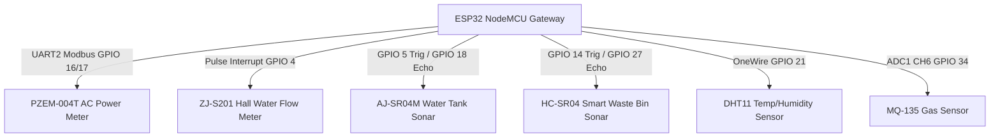

# EstateIQ End-to-End Telemetry Pipeline & Architecture Specification

## 1. What is Connected Today

EstateIQ supports two active telemetry producer paths that converge on the unified backend ingestion route (`POST /api/v1/iot/telemetry`):

1. **In-Dashboard Resource Simulator (`web/js/resource_simulator.js`) & Standalone Simulator (`resource-simulator-app/server.py` on Port 8502)**: Generates physics-grounded synthetic telemetry across Electricity, Water, Environmental, and Waste domains with controllable anomaly triggers.
2. **Physical ESP32 Edge Gateway (`hardware/esp32/firmware/main.ino`)**: Gathers live multi-sensor metrology over hardware buses (Modbus-RTU, GPIO pulse interrupts, analog ADC, and ultrasonic sonar), evaluates edge anomaly rules locally, queues packets in memory, and transmits telemetry packets over Wi-Fi.

The backend validates envelope authenticity, enforces deduplication and chronological ordering, checks gateway cryptographic tokens, updates the live device registry and rolling telemetry buffers, and evaluates contextual anomaly baselines.

> [!IMPORTANT]
> **Stream Delivery Mechanism**: `GET /api/v1/iot/telemetry/stream` returns a point-in-time JSON snapshot of active device telemetry buffers. The web dashboard refreshes using fast HTTP polling (every 3–5 seconds); it does **not** use Server-Sent Events (SSE) or WebSockets. Do not describe the current implementation as push streaming.

---

## 2. Canonical Telemetry Envelope & Metric Schema

Each telemetry transmission must adhere to the canonical EstateIQ envelope format:

```json
{
  "schema_version": "1.0",
  "message_id": "MSG_ESP32_ELEC_20261109_120000_0001",
  "boot_id": "BOOT_B4E62DF8_1731153600",
  "gateway_id": "ESP32_EDGE_GATEWAY_01",
  "auth_token": "gw_secret_estateiq_hw_2026",
  "device_id": "METER-BLOCK-B-001",
  "facility_id": "FAC_GEC_CAMPUS",
  "building_id": "Block B Hostel",
  "source_type": "real_sensor",
  "event_timestamp": "2026-11-09T12:00:00.000Z",
  "sent_timestamp": "2026-11-09T12:00:00.120Z",
  "sequence_number": 42,
  "reporting_interval_sec": 900,
  "metrics": [
    {"metric": "active_power_kw", "value": 2.45, "unit": "kW", "quality": "good"},
    {"metric": "cumulative_energy_kwh", "value": 148.20, "unit": "kWh", "quality": "good"},
    {"metric": "voltage_v", "value": 231.4, "unit": "V", "quality": "good"},
    {"metric": "current_a", "value": 10.6, "unit": "A", "quality": "good"},
    {"metric": "power_factor", "value": 0.96, "unit": "dimensionless", "quality": "good"}
  ]
}
```

### Canonical Metric Units & Ingestion Table

| Canonical Metric Name | Canonical Unit | Valid Physical Range | Compatible Aliases Accepted by Backend |
|---|---|---|---|
| `active_power_kw` | `kW` | 0.0 to 1000.0 | `power_kw`, `active_power`, `load_kw` |
| `cumulative_energy_kwh` | `kWh` | 0.0 to 1,000,000.0 | `energy_kwh`, `total_energy_kwh`, `energy` |
| `voltage_v` | `V` | 0.0 to 500.0 | `line_voltage_v`, `voltage` |
| `current_a` | `A` | 0.0 to 1000.0 | `line_current_a`, `current` |
| `power_factor` | dimensionless | 0.0 to 1.0 | `pf`, `cos_phi` |
| `flow_rate_lmin` | `L/min` | 0.0 to 500.0 | `water_flow_lmin`, `flow_rate`, `water_flow` |
| `cumulative_water_m3` | `m³` | 0.0 to 100,000.0 | `cumulative_volume_m3`, `water_m3` |
| `tank_distance_cm` | `cm` | 2.0 to 450.0 | `distance_cm`, `tank_level_distance` |
| `tank_level_pct` | `%` | 0.0 to 100.0 | `tank_level_percent`, `water_level_pct` |
| `fill_level_percent` | `%` | 0.0 to 100.0 | `fill_level_pct`, `bin_fill_pct`, `bin_fill_percent` |
| `bin_distance_cm` | `cm` | 2.0 to 400.0 | `bin_distance`, `waste_distance_cm` |
| `temperature_c` | `°C` | -10.0 to 65.0 | `room_temperature_c`, `temperature`, `temp_c` |
| `humidity_pct` | `%` | 0.0 to 100.0 | `relative_humidity_pct`, `humidity` |
| `air_quality_raw_adc` | counts | 0 to 4095 | `mq135_raw_adc`, `gas_resistance_raw` |
| `mq135_co2_estimate_ppm` | `ppm` | 300.0 to 5000.0 | `co2_estimate_ppm`, `indoor_aqi` |

---

## 3. Physical Hardware Pin Architecture & Dual Ultrasonic Sonar Routing

The ESP32 firmware operates four discrete sensor channels:



### Dual-Port HC-SR04 / AJ-SR04M Implementation:
1. **Dedicated Waste Sonar Port**: Trig on `GPIO 14`, Echo on `GPIO 27` (using a 1 kΩ / 2 kΩ resistor voltage divider to step 5 V Echo down to 3.3 V for ESP32 GPIO safety).
2. **Dedicated Water & Tank Sonar Port**: Trig on `GPIO 5`, Echo on `GPIO 18` (via 1 kΩ / 2 kΩ divider).
3. **Bench Auto-Route Feature**: When developing on a single bench ultrasonic sensor connected to GPIO 5/18, if dedicated GPIO 14/27 produces no echo, the firmware automatically duplicates the validated sonar reading to `WASTE-BLOCK-B-001`. A rapid distance change ($\ge 3.0\text{ cm}$) immediately triggers an anomaly reporting event, allowing live demonstration of bin fill level tracking and immediate reporting cadence acceleration.

---

## 4. Offline Queue & Volatile Storage Limitations

To maintain data continuity during Wi-Fi disconnects, the ESP32 firmware includes an internal FIFO ring buffer (`OFFLINE_QUEUE_SIZE = 30` packets):

- **In-Memory Ring Buffer**: When Wi-Fi is lost or HTTP post fails, generated JSON payloads are enqueued into a static DRAM ring buffer.
- **Queue Overflow Handling**: If offline time exceeds the buffer capacity (30 packets), the oldest un-flushed packet is dropped to preserve newest readings, and `offline_dropped_counter` increments.
- **Power Loss Limitation**: The buffer resides strictly in volatile ESP32 DRAM. In the event of power interruption or brownout reset, **all un-flushed packets in RAM are permanently lost**. Non-volatile EEPROM/NVS flash logging is deliberately excluded to prevent flash endurance degradation from high-frequency write cycles.
- **Reconnection Burst Drain**: Upon Wi-Fi re-association, the firmware transmits queued packets in chronological order with a 150 ms inter-packet spacing to prevent server-side rate-limiting.

---

## 5. Adaptive Edge Reporting Cadence

Sampling frequency and backend reporting cadence are decoupled:

| Operational State | Edge Sampling Interval | Backend Reporting Interval | Trigger Condition |
|---|---|---|---|
| **Normal Operation** | 10 seconds | 900 seconds (15 minutes) | All sensor metrics within nominal thresholds. |
| **Confirmed Anomaly** | 5 seconds | 300 seconds (5 minutes) | Persistence filter triggers: $\ge 3$ consecutive cycles of out-of-spec readings, or immediate on safety threshold breach. |
| **Recovery Phase** | 10 seconds | 300 seconds (5 minutes) | Remains in fast reporting cadence until 3 consecutive normal cycles are verified, then transitions to Normal. |
| **Demo Fast Cadence** | 1 second | 5 seconds | Enabled explicitly via `#define DEMO_FAST_CADENCE` for stage demonstration. |

---

## 6. Sensor Calibration & Metrology Disclaimers

- **PZEM-004T Power Submeter**: Measures true RMS active power (kW) and accumulated energy (kWh) over RS485 Modbus. Ensure phase voltage and current polarity are correct.
- **ZJ-S201 Flow Sensor**: Pulse count to liter conversion uses pulse factor $k \approx 450\text{ pulses/liter}$. Pulse factor must be calibrated against volumetric vessel testing for final deployments.
- **MQ-135 Gas Sensor**: Uses heated metal oxide semiconductor (SnO2). **Output is raw ADC counts / uncalibrated indicative gas estimates**. It is **not** certified by EPA, CPCB, or OSHA for regulatory PM2.5, CO2, or AQI compliance.
- **AJ-SR04M / HC-SR04 Sonar**: Geometric time-of-flight measurement ($v_{\text{sound}} \approx 343\text{ m/s}$). Tank and bin percentages require accurate physical container dimension configuration (`TANK_HEIGHT_CM`, `BIN_HEIGHT_CM`).

---

## 7. Campus Map Panel Representation

The map rendered in the EstateIQ dashboard is a **schematic topological layout**, not a calibrated GIS coordinate map. Buildings (Block A, Block B Hostel, Cafeteria, Admin) and device nodes are displayed in relative spatial relation to aid facility managers in locating alerts. Marker positions do not represent precision geographic survey coordinates.
