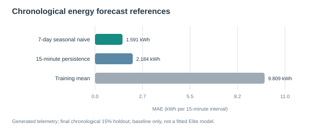
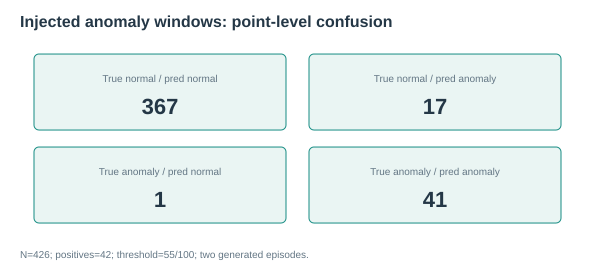
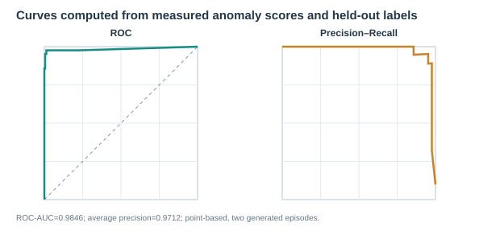
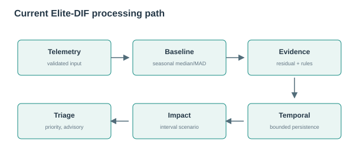

# EstateIQ-DIF reproducible evaluation

Generated (UTC): 2026-11-12T13:51:15.271393+00:00

> All source telemetry and anomaly injections in this evaluation are generated/simulated. These results are not evidence of production or real-facility performance.

## Energy reference forecast

Per-building chronological 70/15/15; final 15% one-step rolling-origin; weekly lag 672
Test interval count: 50,304; test period: 2026-11-07T06:00:00+05:30 to 2026-12-31T23:45:00+05:30.
The seasonal-naive reference is not a trained Elite model. It uses the observed value one week earlier for a one-step rolling forecast.

| Method | MAE (kWh/15 min) | RMSE | R² |
|---|---:|---:|---:|
| 7-day seasonal naive | 1.5910 | 2.3554 | 0.9875 |
| 15-minute persistence | 2.1840 | 4.5601 | 0.9530 |
| Training mean | 9.8093 | 14.7426 | 0.5084 |

## Anomaly episode evaluation

Two generated, labeled energy-injection episodes; training history strictly precedes each episode; ±24-hour windows; score threshold fixed at 55/100
Sample count: 426; positives: 42; threshold: 55.0.
Precision 0.7069; recall 0.9762; F1 0.82; FPR 0.0443; ROC-AUC 0.9846; average precision 0.9712.
The score threshold was fixed before the evaluated labels. This event-window point metric does not measure event-level detection delay. The two generated episodes are too few to support generalization claims.

## Not evaluated

- Water specialist inference: No independent, held-out water model predictions are wired to Elite-DIF.
- Waste specialist inference: Waste overflow is outside Elite-DIF and has no independent evaluation protocol here.
- Decision-level accuracy: No independent operator decision labels; confidence and priority are not accuracy measures.

## Complexity model

| Stage | Time | Space | Assumptions |
|---|---|---|---|
| Input validation and heuristic baseline | O(1) | O(1) | Fixed number of scalar fields; no dataframe supplied. |
| Fitted seasonal baseline lookup | O(1) | O(1) per query | Hash lookup by building and 15-minute weekday slot; fitted profile storage O(S). |
| Rule checks and anomaly score fusion | O(1) | O(1) | Fixed number of scalar rules and evidence signals; no IF/LOF estimator is invoked. |
| Temporal persistence state | O(1) expected | O(B) | Dictionary lookup/update; B is bounded by the configured building-state capacity. |
| Impact, risk and priority arithmetic | O(1) | O(1) | Closed-form calculation; annualized impact is a continuation scenario. |
| Optional dataframe quality scan | O(NF) | O(NF) worst case | N telemetry rows and F columns; used only when a dataframe is passed to analyze. |
| Seasonal baseline fit | O(N) expected | O(N+S) | One-time grouped robust statistics on N training rows, yielding S building/time-slot profiles. |
| Core event path | O(1) expected | O(1) incremental; O(S+B) retained | Fixed model/profile and no optional telemetry dataframe; average-case dictionary operations. |

## Empirical runtime microbenchmark

- N=100: median 0.0441 ms, p95 0.1308 ms, p99 0.1692 ms, throughput 18310.99 events/s (Python 3.11.0 / Windows / AMD64).
- N=1000: median 0.0427 ms, p95 0.057 ms, p99 0.1448 ms, throughput 21217.91 events/s (Python 3.11.0 / Windows / AMD64).

