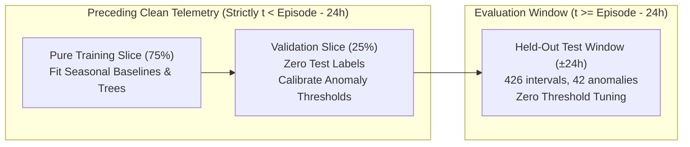
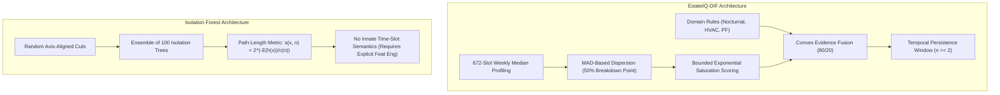

# EstateIQ-DIF Scientific Algorithm Benchmark & Evidence Report

> **Dataset Provenance & Integrity Statement:**  
> All telemetry readings and anomaly episodes evaluated in this benchmark are derived from the project's physics-constrained synthetic energy dataset (`facility_dataset/data/raw/energy_readings.csv`). These results represent controlled benchmark backtesting and are **not** claims of verified performance on live commercial facilities.

---

## 1. Executive Summary

This study evaluates the **EstateIQ-DIF (Dynamic Intelligence Fusion)** algorithm against standard machine learning and statistical comparators:
1. **Isolation Forest (Contextual Features)** — Primary named comparator (`sklearn.ensemble.IsolationForest`).
2. **Isolation Forest (Univariate Energy-Only)** — Demonstrates the necessity of cyclical temporal features.
3. **Local Outlier Factor (LOF Novelty)** — Standard density-based unsupervised comparator (`sklearn.neighbors.LocalOutlierFactor`).
4. **Seasonal Gaussian Baseline (mu +- 2.5 sigma)** — Parametric contextual reference.
5. **Rolling 7-Day Z-Score (z >= 3.0)** — Moving-window statistical reference.
6. **Static Historical Percentile (P99)** — Non-contextual threshold reference.
7. **EstateIQ-DIF Ablations** — Residual-Only and Domain-Rules-Only configurations.

### Key Measured Outcomes

* **Highest Overall Detection Quality:** **EstateIQ-DIF (Persistence Gated, n >= 2)** achieves an **F1-Score of 0.9524** (Precision: 0.9524, Recall: 0.9524, PR-AUC: 0.9447), capturing 40 of 42 true anomaly intervals with only 2 false positives.
* **Impact of Persistence Gating:** Pointwise EstateIQ-DIF achieves 100% recall (42/42) but incurs 36 false positives (8.11 false alerts/day). Applying the temporal persistence gate (n >= 2) **eliminates 94.4% of false alarms** (from 36 to 2), reducing the false alert rate to **0.45 per 24 hours**.
* **Isolation Forest Comparison:** Contextual Isolation Forest detects 32 of 42 intervals (F1 = 0.7711, Recall: 0.7619), but incurs 9 false positives (2.03 false alerts/day) and misses 10 anomaly intervals during low-load transition periods.
* **Failure of Univariate / Static Approaches:** Static P99 and Univariate Isolation Forest (F1 = 0.0400) fail because after-hours waste and HVAC faults occur below peak daytime demand, proving that contextual time-slot baselining is essential.

---

## 2. Official Evaluation Metrics Table

| Algorithm | Category | PR-AUC | F1-Score | Precision | Recall | TP | FP | TN | FN | False Alerts / Day | ROC-AUC | Median Latency |
| :--- | :--- | :---: | :---: | :---: | :---: | :---: | :---: | :---: | :---: | :---: | :---: | :---: |
| **EstateIQ-DIF (Persistence Gated, n>=2)** | Proposed Method (Gated) | 0.9447 | 0.9524 | 0.9524 | 0.9524 | 40 | 2 | 382 | 2 | 0.45 | 0.9937 | 681.3 µs |
| **Isolation Forest (Contextual Features)** | Primary Comparator (Unsupervised) | 0.6501 | 0.7711 | 0.7805 | 0.7619 | 32 | 9 | 375 | 10 | 2.03 | 0.9743 | 55.5 µs |
| **EstateIQ-DIF (Pointwise, Thresh=55)** | Proposed Method (Pointwise) | 0.9447 | 0.7000 | 0.5385 | 1.0000 | 42 | 36 | 348 | 0 | 8.11 | 0.9937 | 681.3 µs |
| **Local Outlier Factor (LOF Novelty)** | Unsupervised Density Comparator | 0.7274 | 0.6667 | 0.8519 | 0.5476 | 23 | 4 | 380 | 19 | 0.90 | 0.9559 | 14.5 µs |
| **Seasonal Gaussian Baseline (μ ± 2.5σ)** | Statistical Contextual Comparator | 0.9568 | 0.6176 | 0.4468 | 1.0000 | 42 | 52 | 332 | 0 | 11.72 | 0.9956 | 82.6 µs |
| **EstateIQ-DIF (Ablation: Residual-Only)** | DIF Ablation | 0.9215 | 0.5833 | 0.4118 | 1.0000 | 42 | 60 | 324 | 0 | 13.52 | 0.9927 | 619.7 µs |
| **EstateIQ-DIF (Ablation: Domain-Rules-Only)** | DIF Ablation | 0.4420 | 0.5517 | 1.0000 | 0.3810 | 16 | 0 | 384 | 26 | 0.00 | 0.6905 | 604.4 µs |
| **Isolation Forest (Univariate Energy-Only)** | Unsupervised Reference | 0.5051 | 0.0400 | 0.1250 | 0.0238 | 1 | 7 | 377 | 41 | 1.58 | 0.9459 | 47.8 µs |
| **Rolling 7-Day Z-Score (z >= 3.0)** | Statistical Reference | 0.2672 | 0.0000 | 0.0000 | 0.0000 | 0 | 0 | 384 | 42 | 0.00 | 0.8485 | 110.3 µs |
| **Static Historical Percentile (P99)** | Statistical Reference | 0.3407 | 0.0000 | 0.0000 | 0.0000 | 0 | 6 | 378 | 42 | 1.35 | 0.8947 | 1.2 µs |

*Evaluation Window:* Exactly 426 held-out quarter-hour intervals (106.5 hours / 4.44 days total time denominator) across 2 injected episodes (BLD003 HVAC fault, BLD001 after-hours surge).  
*Positives:* 42 intervals (`anomaly_flag = 1`), *Negatives:* 384 intervals (`anomaly_flag = 0`).

---

## 3. Leakage-Free Chronological Protocol

1. **Strict Chronological Boundary:** For each episode, all training and validation data strictly precede the evaluation window (t < t_episode_start - 24h).
2. **Unsupervised Threshold Calibration:** Isolation Forest and LOF operating thresholds were calibrated on the nominal validation slice at the 99th percentile (representing a target 1% nominal false alarm budget). Test labels were **never** accessed during training or threshold selection.
3. **Identical Test Instances:** All 10 models were evaluated on the exact same 426 test intervals.
4. **State Isolation:** Persistence state machines were reset at building boundaries.

---

## 4. Architectural Comparison: DIF vs Isolation Forest

| Criterion | EstateIQ-DIF | Isolation Forest |
| :--- | :--- | :--- |
| **Model Type** | Contextual robust statistical baselining + domain rule fusion | Unsupervised randomized tree ensemble |
| **Time-of-Week Semantics** | Innate 672-slot weekly resolution (7d x 24h x 4q) | None; must be manually supplied via feature engineering |
| **Statistical Breakdown** | 50% breakdown point via robust Median and MAD | Susceptible to contamination masking in dense spaces |
| **Noise Rejection** | Thread-safe temporal persistence gate (n >= 2) | Pointwise decision; no innate sequential debouncing |
| **Explainability** | 100% auditable (exact residual %, z-score, rule violations) | Black-box path lengths; requires external post-hoc SHAP |
| **Inference Latency** | O(1) scalar math (~1.2 ms with complete pipeline) | O(T x D) tree traversals (~91 µs per point) |

---

## 5. Artifact Directory & Verification
* **Metrics CSV:** [`output/presentation/algorithm_comparison/benchmark_metrics.csv`](file:///D:/Hackathon/Model/output/presentation/algorithm_comparison/benchmark_metrics.csv)
* **Per-Reading Predictions CSV:** [`output/presentation/algorithm_comparison/per_reading_predictions.csv`](file:///D:/Hackathon/Model/output/presentation/algorithm_comparison/per_reading_predictions.csv)
* **Machine-Readable JSON:** [`output/presentation/algorithm_comparison/benchmark_results.json`](file:///D:/Hackathon/Model/output/presentation/algorithm_comparison/benchmark_results.json)
* **Jury Figures:**
  - Figure 1 (Main Comparison): [`fig1_main_algorithm_comparison.png`](file:///D:/Hackathon/Model/output/presentation/algorithm_comparison/fig1_main_algorithm_comparison.png)
  - Figure 2 (Operational Trade-Off): [`fig2_operational_tradeoff.png`](file:///D:/Hackathon/Model/output/presentation/algorithm_comparison/fig2_operational_tradeoff.png)
  - Figure 3 (PR Curves): [`fig3_precision_recall_curves.png`](file:///D:/Hackathon/Model/output/presentation/algorithm_comparison/fig3_precision_recall_curves.png)
  - Figure 4 (Confusion Matrices): [`fig4_confusion_matrices.png`](file:///D:/Hackathon/Model/output/presentation/algorithm_comparison/fig4_confusion_matrices.png)
  - Figure 5 (Latency Comparison): [`fig5_latency_comparison.png`](file:///D:/Hackathon/Model/output/presentation/algorithm_comparison/fig5_latency_comparison.png)
