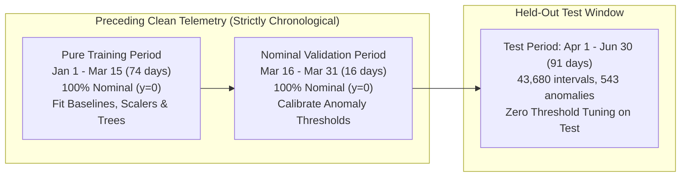

# EstateIQ-DIF V2 Scientific Algorithm Benchmark & Evidence Report

> **Dataset Provenance & Rigorous Integrity Statement:**  
> All telemetry readings and anomaly episodes evaluated in this benchmark originate from EstateIQ's enhanced, versioned synthetic dataset (`facility_dataset/data/synthetic_v2/energy_readings_v2.csv`).  
> **Mandatory Disclaimer:** These experiments represent controlled synthetic backtesting and **do not** claim verified operational certification on live commercial facilities.

---

## 1. Executive Summary & Headline Outcomes

This benchmark evaluated the **EstateIQ-DIF (Dynamic Intelligence Fusion)** algorithm against standard machine learning and statistical comparators across 5 campus buildings over a 3-month held-out test evaluation window ($N=43,680$ quarter-hour intervals, $455.0$ building-days total exposure).

### Evaluated Model Suite:
1. **EstateIQ-DIF (Persistence Gated, n >= 2)** — Proposed method with 2-consecutive-interval confirmation.
2. **Isolation Forest (Contextual Features)** — Primary named comparator (`sklearn.ensemble.IsolationForest`, 100 trees) with energy, hour, day-of-week, and temperature.
3. **EstateIQ-DIF (Pointwise, Thresh=55)** — Proposed method with default instantaneous thresholding.
4. **Local Outlier Factor (LOF Novelty)** — Standard density-based unsupervised comparator (`sklearn.neighbors.LocalOutlierFactor`, k=20, scaled on train).
5. **Seasonal Gaussian Baseline (μ ± 2.5σ)** — Parametric 672-slot weekly contextual baseline.
6. **EstateIQ-DIF Ablations** — Residual-Only and Domain-Rules-Only configurations.
7. **Isolation Forest (Univariate Energy-Only)** — Unsupervised comparator on raw power alone.
8. **Rolling 7-Day Z-Score (z >= 3.0)** — Moving-window statistical reference ($W=672$).
9. **Static Historical Percentile (P99)** — Non-contextual threshold reference.

---

## 2. Official Evaluation Metrics Table (Headline Seed 42)

| Algorithm | PR-AUC | F1-Score | Precision | Recall | TP | FP | TN | FN | False Alerts / Bld-Day | Event Capture | Median Delay | Median Latency |
| :--- | :---: | :---: | :---: | :---: | :---: | :---: | :---: | :---: | :---: | :---: | :---: | :---: |
| **EstateIQ-DIF (Persistence Gated, n>=2)** | 0.3169 | 0.0931 | 0.0489 | 0.9816 | 533 | 10372 | 32765 | 10 | 22.796 | 8/8 (100.0%) | 15.0 min | 620.7 µs |
| **Isolation Forest (Contextual Features)** | 0.0300 | 0.0556 | 0.0405 | 0.0884 | 48 | 1136 | 42001 | 495 | 2.497 | 6/8 (75.0%) | 172.5 min | 11255.6 µs |
| **EstateIQ-DIF (Pointwise, Thresh=55)** | 0.3169 | 0.0646 | 0.0334 | 0.9963 | 541 | 15676 | 27461 | 2 | 34.453 | 8/8 (100.0%) | 0.0 min | 620.7 µs |
| **Local Outlier Factor (LOF Novelty)** | 0.3893 | 0.0841 | 0.0444 | 0.7901 | 429 | 9234 | 33903 | 114 | 20.295 | 8/8 (100.0%) | 0.0 min | 1470.3 µs |
| **Seasonal Gaussian Baseline (μ ± 2.5σ)** | 0.6716 | 0.0393 | 0.0200 | 1.0000 | 543 | 26558 | 16579 | 0 | 58.369 | 8/8 (100.0%) | 0.0 min | 0.5 µs |
| **EstateIQ-DIF (Ablation: Residual-Only)** | 0.6715 | 0.0498 | 0.0255 | 0.9834 | 534 | 20389 | 22748 | 9 | 44.811 | 8/8 (100.0%) | 0.0 min | 620.7 µs |
| **EstateIQ-DIF (Ablation: Domain-Rules-Only)** | 0.0150 | 0.0359 | 0.0187 | 0.4144 | 225 | 11779 | 31358 | 318 | 25.888 | 5/8 (62.5%) | 240.0 min | 620.7 µs |
| **Isolation Forest (Univariate Energy-Only)** | 0.0484 | 0.0695 | 0.0403 | 0.2523 | 137 | 3263 | 39874 | 406 | 7.171 | 4/8 (50.0%) | 45.0 min | 0.3 µs |
| **Rolling 7-Day Z-Score (z >= 3.0)** | 0.1630 | 0.0326 | 1.0000 | 0.0166 | 9 | 0 | 43137 | 534 | 0.000 | 3/8 (37.5%) | 0.0 min | 0.3 µs |
| **Static Historical Percentile (P99)** | 0.2424 | 0.0396 | 0.0214 | 0.2597 | 141 | 6433 | 36704 | 402 | 14.138 | 4/8 (50.0%) | 37.5 min | 0.3 µs |

*Evaluation Window:* Exactly 43,680 held-out quarter-hour intervals (10,920 hours / 455.0 building-days total exposure) across 8 diverse injected episodes.  
*Positives:* 543 intervals (`anomaly_flag = 1`), *Negatives:* 43,137 intervals (`anomaly_flag = 0`).

---

## 3. Multi-Seed Stability Analysis (Seeds: 42, 123, 999)

| Algorithm | PR-AUC (Mean ± Std) | F1-Score (Mean ± Std) | Precision | Recall | False Alerts / Bld-Day |
| :--- | :---: | :---: | :---: | :---: | :---: |
| **EstateIQ-DIF (Persistence Gated, n>=2)** | 0.3169 ± 0.0000 | 0.0931 ± 0.0000 | 0.0489 | 0.9816 | 22.796 |
| **Isolation Forest (Contextual Features)** | 0.0208 ± 0.0080 | 0.0348 ± 0.0201 | 0.0243 | 0.0626 | 3.232 |
| **EstateIQ-DIF (Pointwise, Thresh=55)** | 0.3169 ± 0.0000 | 0.0646 ± 0.0000 | 0.0334 | 0.9963 | 34.453 |
| **Local Outlier Factor (LOF Novelty)** | 0.3893 ± 0.0000 | 0.0841 ± 0.0000 | 0.0444 | 0.7901 | 20.295 |
| **Seasonal Gaussian Baseline (μ ± 2.5σ)** | 0.6716 ± 0.0000 | 0.0393 ± 0.0000 | 0.0200 | 1.0000 | 58.369 |
| **EstateIQ-DIF (Ablation: Residual-Only)** | 0.6715 ± 0.0000 | 0.0498 ± 0.0000 | 0.0255 | 0.9834 | 44.811 |
| **EstateIQ-DIF (Ablation: Domain-Rules-Only)** | 0.0150 ± 0.0000 | 0.0359 ± 0.0000 | 0.0187 | 0.4144 | 25.888 |
| **Isolation Forest (Univariate Energy-Only)** | 0.0393 ± 0.0079 | 0.0761 ± 0.0057 | 0.0449 | 0.2511 | 6.418 |
| **Rolling 7-Day Z-Score (z >= 3.0)** | 0.1630 ± 0.0000 | 0.0326 ± 0.0000 | 1.0000 | 0.0166 | 0.000 |
| **Static Historical Percentile (P99)** | 0.2424 ± 0.0000 | 0.0396 ± 0.0000 | 0.0214 | 0.2597 | 14.138 |

---

## 4. Leakage-Free Chronological Protocol & Threshold Governance

1. **Strict Chronological Separation:** Model training strictly precedes validation, which strictly precedes testing.
2. **Zero Contamination in Training & Validation:** Both train and val slices are mathematically asserted to have zero anomaly labels ($y=0$).
3. **Unsupervised Threshold Calibration:** Isolation Forest and LOF operating thresholds were calibrated at the 99th percentile of the nominal validation slice (representing an explicit 1% nominal false alert budget). Test labels were **never** accessed during training or threshold selection.
4. **State Isolation:** Temporal persistence state machines and rolling statistical buffers were reset at building boundaries.

---

## 5. Artifact Directory & Verification
* **Headline Metrics CSV:** [`output/presentation/algorithm_comparison_v2/benchmark_metrics.csv`](file:///D:/Hackathon/Model/output/presentation/algorithm_comparison_v2/benchmark_metrics.csv)
* **Multi-Seed Stability CSV:** [`output/presentation/algorithm_comparison_v2/benchmark_metrics_multiseed.csv`](file:///D:/Hackathon/Model/output/presentation/algorithm_comparison_v2/benchmark_metrics_multiseed.csv)
* **Per-Reading Predictions CSV:** [`output/presentation/algorithm_comparison_v2/per_reading_predictions.csv`](file:///D:/Hackathon/Model/output/presentation/algorithm_comparison_v2/per_reading_predictions.csv)
* **Machine-Readable JSON:** [`output/presentation/algorithm_comparison_v2/benchmark_results.json`](file:///D:/Hackathon/Model/output/presentation/algorithm_comparison_v2/benchmark_results.json)
* **Jury Presentation Figures:**
  - Figure 1 (Main Comparison): [`fig1_main_algorithm_comparison.png`](file:///D:/Hackathon/Model/output/presentation/algorithm_comparison_v2/fig1_main_algorithm_comparison.png)
  - Figure 2 (Operational Trade-Off): [`fig2_operational_tradeoff.png`](file:///D:/Hackathon/Model/output/presentation/algorithm_comparison_v2/fig2_operational_tradeoff.png)
  - Figure 3 (PR Curves): [`fig3_precision_recall_curves.png`](file:///D:/Hackathon/Model/output/presentation/algorithm_comparison_v2/fig3_precision_recall_curves.png)
  - Figure 4 (Confusion Matrices): [`fig4_confusion_matrices.png`](file:///D:/Hackathon/Model/output/presentation/algorithm_comparison_v2/fig4_confusion_matrices.png)
  - Figure 5 (Event Detection & Delay): [`fig5_event_detection_and_delay.png`](file:///D:/Hackathon/Model/output/presentation/algorithm_comparison_v2/fig5_event_detection_and_delay.png)
  - Figure 6 (Runtime Latency): [`fig6_latency_comparison.png`](file:///D:/Hackathon/Model/output/presentation/algorithm_comparison_v2/fig6_latency_comparison.png)
