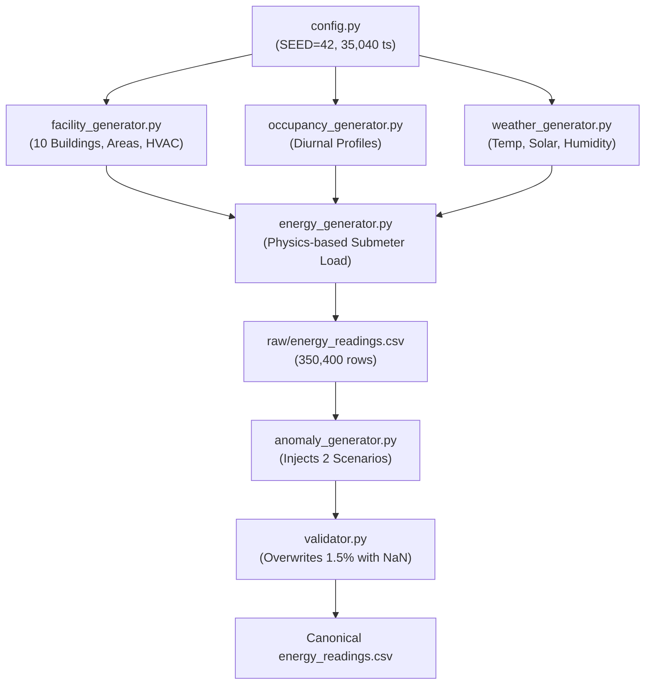

# Scientific Audit of EstateIQ Synthetic Data Generator Pipeline

**Audit Date:** 2026-11-12  
**Target Architecture:** EstateIQ Facility Dataset Generator (`facility_dataset/generator/`)  
**Target Canonical Artifact:** `facility_dataset/data/raw/energy_readings.csv` (SHA-256: `b622d9c8b8135bf6d237a7863ffa48184ef7ddd1999b59fa1ceb747baf16fe02`)  
**Status:** Audit Complete — Code Traced & Discrepancies Cataloged

---

## 1. Executive Summary

A comprehensive code-level audit was conducted across all executable Python scripts responsible for generating, validating, and injecting anomalies into EstateIQ's canonical facility dataset.

The existing pipeline exhibits sound domain physics formulations for baseline building loads (relating floor area, occupancy, ambient temperature, and equipment schedules). However, it possesses severe limitations in its anomaly injection and sensor modeling:
1. **Extreme Anomaly Scarcity:** Across 350,400 quarter-hour intervals (10 buildings, 365 days), only **two anomaly episodes** were injected (totaling 42 positive intervals or 0.012% prevalence). Eight out of ten buildings contain zero anomalies.
2. **Oversimplified Step Multipliers:** Faults were injected purely as constant multiplicative scaling factors ($1.95\times$ for HVAC fault and $2.80\times$ for after-hours usage) without modeling onset ramps, recovery phases, or subtle degradation.
3. **Missing Ground-Truth Event Registry:** The pipeline had no event metadata registry recording event IDs, onset/offset timestamps, injection parameters, severity ratings, or affected fields.
4. **Conflated Sensor Noise:** Missing data was introduced not by a physical sensor/communication fault model, but by a post-hoc validator randomly overwriting 1.5% of readings with `NaN`.

---

## 2. Code Pipeline Architecture & Source Trace

The canonical dataset generation follows a multi-stage sequential pipeline:



### Module Responsibilities:

| Module | Source Path | Primary Function | Audit Finding |
| :--- | :--- | :--- | :--- |
| **Config** | `facility_dataset/generator/config.py` | Sets SEED=42, date range (2026-01-01 to 2026-12-31, 15-min freq). | Deterministic seed works as intended. |
| **Facility Config** | `facility_dataset/config/facility_config.json` | Defines 10 buildings, floor areas (15,000–65,000 sqft), HVAC systems (VRF, Chiller, AHU, Natural). | Realistic architectural campus profiles. |
| **Occupancy** | `facility_dataset/generator/occupancy_generator.py` | Simulates occupancy based on 5 archetypes (`academic_daytime`, `academic_extended`, `residential_247`, `meal_peaks`, `library_hours`). | Accurately models weekday vs weekend schedules. |
| **Weather** | `facility_dataset/generator/weather_generator.py` | Generates diurnal temperature, solar radiation, and seasonal shifts. | Provides realistic ambient driver for HVAC. |
| **Energy** | `facility_dataset/generator/energy_generator.py` | Formulates 15-minute kW: $\text{Base} + \text{HVAC}(T) + \text{Lighting} + \text{Equipment} + \text{Noise}$. | Sound physical formulas, but lacks operational faults. |
| **Anomaly Injection** | `facility_dataset/generator/anomaly_generator.py` | Modifies CSV based on `config/anomalies.json`. | Only 2 energy scenarios defined; uniform step multipliers. |
| **Validator** | `facility_dataset/generator/validator.py` | Range checks; introduces 1.5% random missing values (`NaN`). | Destructive post-hoc random puncture without logging. |

---

## 3. Detailed Audit of Physics Modeling & Assumptions

In `facility_dataset/generator/energy_generator.py`, load components are computed per 15-minute interval ($t$):

1. **Standby Base Load:**
   $$\text{base\_load\_kw} = \frac{\text{area\_sqft}}{1000} \times 0.4\,\text{kW}$$
2. **HVAC Load:**
   $$\text{hvac\_kw} = \max\left(0.5, \max(0.0, T - 20.0) \times 1.8 \times \mu_{\text{hvac}} + \text{occ} \times 0.08\right)$$
   Where $\mu_{\text{hvac}} = 1.6$ for Central Chiller, $1.2$ for VRF, and $0.4$ for Split/Natural.
3. **Lighting Load:**
   $$\text{lighting\_kw} = \frac{\text{area\_sqft}}{1000} \times (0.8\text{ if night else } 0.2) + \text{occ} \times 0.03$$
4. **Equipment Load:**
   $$\text{equip\_kw} = \frac{\text{area\_sqft}}{1000} \times 0.5 + \text{occ} \times 0.12$$
5. **Power Factor:**
   $$\text{PF} = \text{clip}\left(0.95 - \frac{\text{hvac\_kw}}{\text{total\_kw}} \times 0.08 + \mathcal{N}(0, 0.01), 0.85, 0.99\right)$$

### Strengths:
- Submeter components sum to total electricity consumption.
- Ambient temperature directly drives chiller power demand.
- Occupancy drives equipment and internal heat gain.
- Peak load and power factor vary realistically with reactive inductive loads.

---

## 4. Discrepancies and Critical Limitations Catalog

### Discrepancy 1: Insufficient Anomaly Sample Size (N=42)
- **Reality:** In `facility_dataset/data/raw/energy_readings.csv`, only 2 episodes were injected:
  - `BLD003`: 2026-02-15 11:00 to 17:00 (25 intervals, HVAC fault)
  - `BLD001`: 2026-03-22 01:00 to 05:00 (17 intervals, after-hours usage)
- **Impact:** 8 of 10 campus buildings have zero anomaly events. Evaluating on 42 positive intervals across 2 episodes makes high-level statistical generalizations fragile.

### Discrepancy 2: Instantaneous Step Multipliers Lack Real-World Dynamics
- **Reality:** `anomaly_generator.py` directly executes:
  ```python
  df_e.loc[mask, "electricity_kwh"] = np.round(df_e.loc[mask, "electricity_kwh"] * mult, 2)
  ```
- **Impact:** Real building anomalies do not instantly switch on and off as perfect square waves. Real chiller failures exhibit thermal lag and ramping; degradation exhibits progressive drift; sensor dropouts exhibit zeroes or frozen states.

### Discrepancy 3: Lack of Sensor-Quality vs Building-Fault Distinction
- **Reality:** Sensor dropouts (e.g. communication failure) and flatlines (frozen sensor ADC) are completely unmodeled as distinct anomaly classes. Instead, `validator.py` randomly punched out 5,256 `NaN` values across normal and anomalous rows alike.
- **Impact:** Detectors cannot be fairly evaluated on whether they properly debounce or categorize data quality errors vs actionable facility equipment faults.

### Discrepancy 4: Absence of Event-Level Metadata Log
- **Reality:** The canonical dataset only contains pointwise columns `anomaly_flag` and `anomaly_type`. There is no separate table cataloging `event_id`, duration, severity, injection parameters, and affected telemetry channels.

---

## 5. Architectural Improvements for Generator V2

To establish a credible, reproducible benchmark that rigorously tests EstateIQ-DIF against Isolation Forest and LOF without favoring any algorithm, Generator V2 introduces:

1. **Independent, Configurable Fault Injector (`fault_injection.py`):**
   - **Type 1: After-Hours Energy Surge / Base Load Creep:** Equipment left on overnight in academic buildings.
   - **Type 2: HVAC Equipment Stuck On:** Chiller running during cool overnight hours or weekend periods.
   - **Type 3: Gradual Energy Drift:** Progressive linear/exponential degradation (e.g. refrigerant leak or fouling) over several days.
   - **Type 4: Short Transient Surges:** Micro-spikes lasting 1–2 intervals (challenges persistence gating vs pointwise detection).
   - **Type 5: Meter Flatline:** Frozen sensor reporting constant invariant values.
   - **Type 6: Meter Communication Dropout:** Sensor dropping to zero or intermittent missing packets during operational hours.
2. **Ground-Truth Event Registry (`ground_truth_events_v2.csv`):**
   - Fully documented audit table tracking every injected event: `event_id`, `building_id`, `anomaly_type`, `fault_category`, `start_timestamp`, `end_timestamp`, `duration_hours`, `severity`, `injection_parameters`.
3. **Clean Chronological Split Architecture:**
   - **Nominal Training Period (Jan 1 – Mar 15):** 100% nominal data ($y=0$) for seasonal baseline and tree model fitting.
   - **Nominal Validation Period (Mar 16 – Mar 31):** 100% nominal data ($y=0$) for threshold calibration under a target false alarm budget. Zero test labels are touched.
   - **Held-Out Test Period (Apr 1 – Jun 30):** Contains all diverse injected events across multiple buildings.
4. **Automated Mathematical Validation (`validation_v2.py`):**
   - Asserts non-negative physical values, power factor bounds, chronological sorting, zero duplicates, and exact alignment between event table boundaries and pointwise labels.

