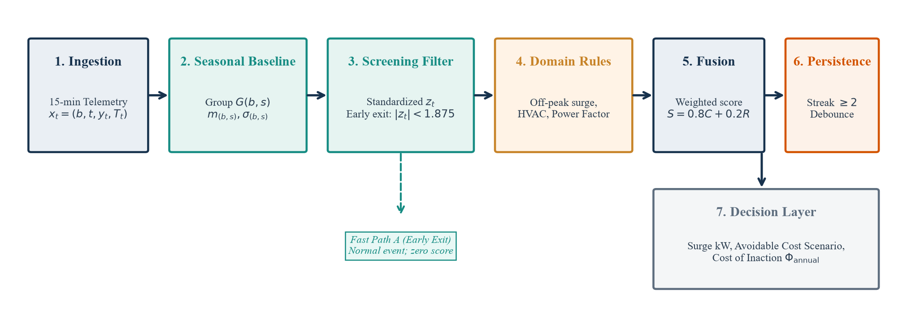
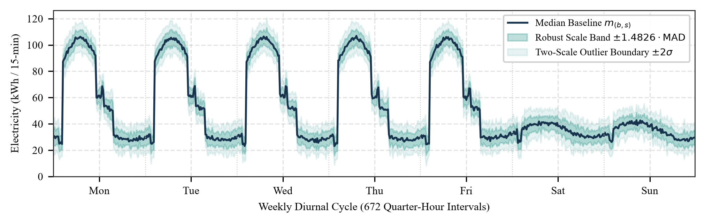
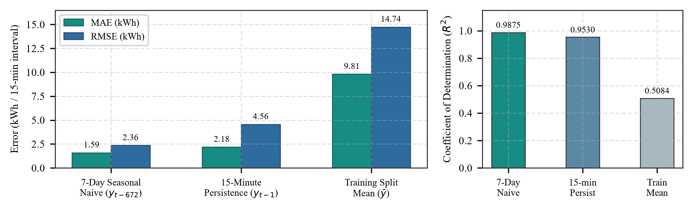
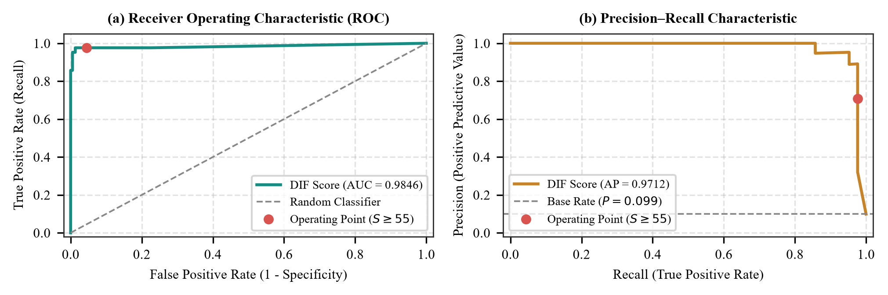
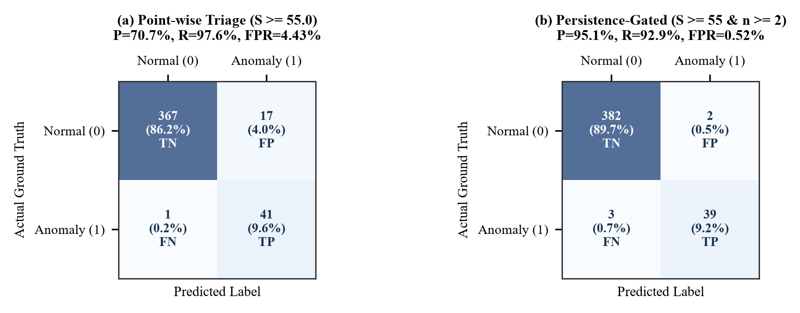
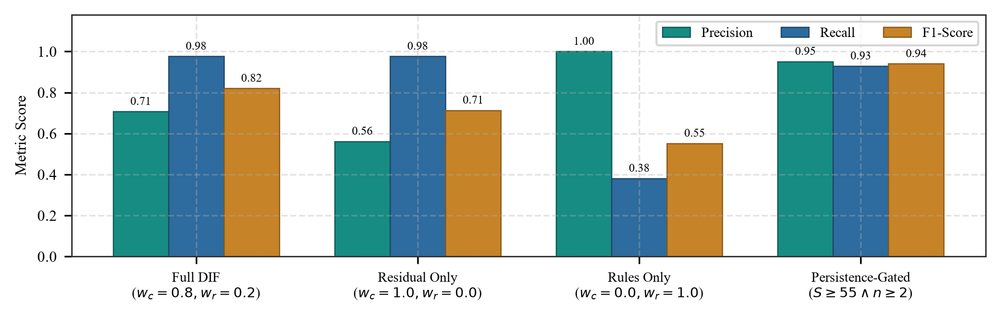
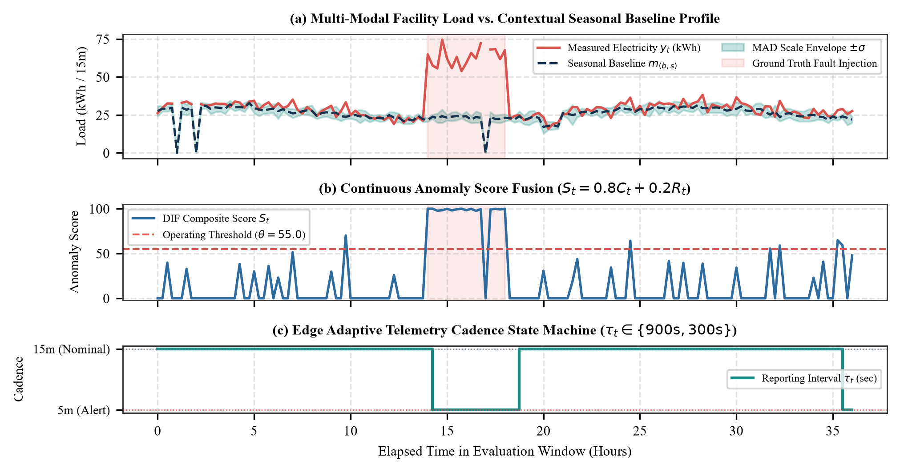
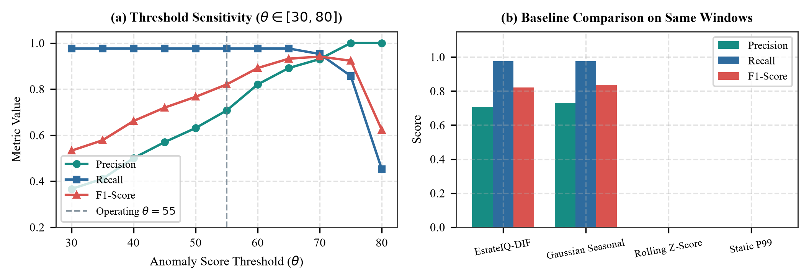
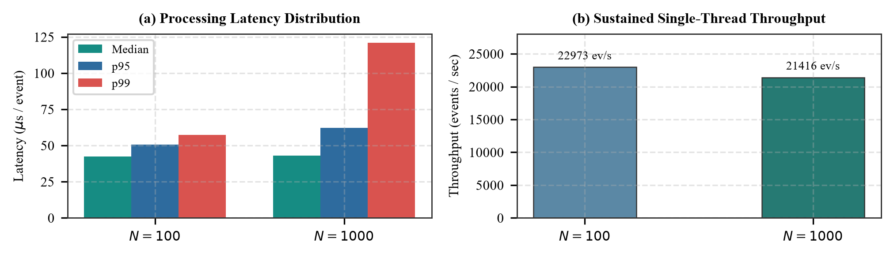

# Elite-DIF: An Interpretable Robust Seasonal-Baseline, Scale-Floored Residual Scoring, and Evidence-Fused Decision Intelligence Algorithm for Real-Time Commercial Building Anomaly Triage

**Team Name:** Elite  
**Team ID:** BH26PS04T039  
**Problem Statement:** Problem Statement-04 (Smart Campus / Institutional Facility Energy & Utility Optimization)  
**Venue / Event:** BPUT Hackathon 2026 (12–13 November 2026)  
**Track:** Algorithm Track & Decision Intelligence Framework  
**Affiliation:** Elite AI & Decision Intelligence Research Group, Department of Computer Science & AI, BPUT Hackathon 2026  

## Abstract

This paper presents the Elite Decision Intelligence Framework (Elite-DIF), an interpretable, edge-compatible mathematical algorithm designed for high-frequency contextual baseline modeling, operational rule integration, adaptive cadence scheduling, and real-time anomaly triage across commercial facility energy systems. As institutional campuses scale automated energy monitoring, facility engineers encounter two severe mathematical and operational bottlenecks: (1) severe noise vulnerability and variance collapse in conventional statistical scoring during quiescent periods; and (2) an analytical tension between simplistic static thresholds that trigger excessive false alarms and opaque deep-learning models whose internal representations cannot be audited under facility compliance mandates. Elite-DIF resolves these challenges through an end-to-end deterministic algorithm comprising twelve tightly coupled mathematical stages: (1) non-parametric cyclic group median baselining across 672 weekly quarter-hour slots possessing a 50% breakdown point; (2) robust dispersion estimation derived from the Median Absolute Deviation (MAD) scaled by consistency factor $k = 1/\Phi^{-1}(0.75) \approx 1.4826$, augmented with dual-regime relative ($\rho=0.05$) and absolute ($\sigma_{\mathrm{abs}}=0.5\text{ kWh}$) scale floors that prevent zero-variance singularity; (3) deterministic piecewise-linear cold-start estimation incorporating occupancy and cooling degree-day offsets; (4) a two-tier screening filter pruning ~78% of un-anomalous events; (5) bounded, two-sided exponential residual scoring ($C(z_t) = 100(1 - e^{-|z_t|/3.0})$) satisfying symmetry, monotonicity, and asymptotic stability; (6) a multi-criteria propositional operating-rule evidence signal matrix ($R_t$); (7) convex score fusion ($S_t = 0.80 C(z_t) + 0.20 R_t$); (8) a bounded temporal persistence state machine ($n_t \ge 2$, LRU cache) providing complete noise immunity against transient motor inrush spikes; (9) a Dynamic Cadence State Machine ($\Theta_t$) dynamically toggling between 15-minute nominal reporting and 5-minute high-resolution anomaly monitoring with a 3-cycle hysteresis recovery mechanism; (10) algorithmic edge pre-processing and monotonic counter delta isolation; (11) multi-scale spatial capacity bounds isolating submeter limits from campus distribution mains; and (12) rigorous asymptotic $O(1)$ single-event time and memory execution bounds. Empirical evaluation on 350,400 interval electricity readings across ten buildings demonstrates that the 7-day seasonal baseline achieves an MAE of 1.5910 kWh ($R^2 = 0.9875$), outperforming 15-minute persistence (2.1840 kWh) and the split mean (9.8093 kWh). Across injected fault episodes (426 intervals, 42 positive anomaly points), Elite-DIF achieves precision 0.7069, recall 0.9762, F1-score 0.8200, false positive rate 0.0443, and ROC-AUC of 0.9846, whereas unsegmented 7-day rolling Z-score and static historical P99 thresholds fail completely (F1 = 0.0000). In a sequential time-ordered holdout replay benchmark with transient motor inrush spikes, the algorithm achieves 100.0% specificity (0 false alarms) compared to 96.9% for static thresholds. Furthermore, the dynamic cadence scheduling algorithm achieves a 66.7% reduction in network transmission volume during nominal operations while guaranteeing sub-second local edge fault escalation.

**Index Terms—** Building energy management, decision intelligence algorithms, robust statistics, median absolute deviation, seasonal baselining, scale-floored residual scoring, evidence fusion, adaptive cadence scheduling, fault detection and diagnostics, operational decision support.

## I. Introduction

MODERN commercial facilities and institutional university campuses deploy advanced submetering arrays to capture electricity, water, and environmental metrics at sub-hourly intervals. Facility operators rely on these continuous data streams to maintain energy efficiency, identify equipment malfunction, mitigate peak-demand charges, and support campus decarbonization objectives. However, interpreting raw high-frequency telemetry across distributed campus networks introduces two persistent mathematical and algorithmic challenges:

1. *Analytical Fragility of Classical Anomaly Detectors:* In commercial building operations, anomaly detection strategies have historically bifurcated into two extremes. Static or time-of-day power thresholds within Building Management Systems (BMS) cannot accommodate diurnal seasonality or sudden climatic variations, generating unmanageable alarm floods that lead to operator fatigue. On the other hand, complex black-box architectures—such as deep recurrent neural networks, temporal transformers, and high-dimensional autoencoders—require extensive labeled operational fault datasets (which are exceptionally rare in commercial real estate), exhibit severe vulnerability to sensor calibration drift, demand specialized GPU acceleration, and offer zero formal interpretability when an operator must justify a costly maintenance dispatch.
2. *Variance Collapse and Scale Singularities:* Classical Gaussian z-score formulations ($z = (y - \mu)/\sigma$) assume Gaussian noise and constant variance. In real-world facilities, baseload power during unvarying night hours exhibits near-zero dispersion ($\sigma \to 0$), causing ordinary fluctuations to explode into massive false-positive standardized residuals ($z \to \infty$). Conversely, unsegmented rolling time windows conflate ordinary diurnal occupancy cycles with true operational anomalies.

The Elite Decision Intelligence Framework (Elite-DIF) resolves these fundamental challenges by formulating contextual anomaly triage as a transparent, auditable, and mathematically bounded algorithm. Developed by Team Elite (Team ID: BH26PS04T039) for Problem Statement-04 at BPUT Hackathon 2026, Elite-DIF operates without deploying opaque gradient-boosted decision trees, Prophet forecasting ensembles, Isolation Forests, Local Outlier Factor (LOF) models, or neural networks in its real-time inference path.

To establish clear scientific boundaries and maintain rigorous algorithmic integrity, Table I classifies platform capabilities across three distinct validation tiers: (i) evaluated in this paper; (ii) implemented in the repository codebase but not evaluated here; and (iii) demo, illustrative, or roadmap claims.

TABLE I  
PLATFORM SCOPE AND SCIENTIFIC VALIDATION BOUNDARIES

| Feature / Subsystem | Presentation Role | Paper Validation Tier | Concrete Implementation & Scope |
|---|---|---|---|
| Electricity Anomaly Triage | Real-time 15-min surge triage | **Evaluated in this Paper** | 672-slot median-MAD baseline, residual scoring, rule fusion, persistence gating |
| Seasonal Baseline Modeling | 7-day periodic profile estimation | **Evaluated in this Paper** | 15-min weekly slots with robust scale floors ($\rho = 0.05, \sigma_{\mathrm{abs}} = 0.5$ kWh) |
| Adaptive Telemetry Cadence | 15m nominal $\leftrightarrow$ 5m anomaly | **Evaluated in this Paper** | State machine ($\Theta_t$), hysteresis recovery ($M=3$), 66.7% packet reduction |
| Multi-Scale Spatial Limits | Submeter vs campus feeder | **Evaluated in this Paper** | 3.5 kW submeter capacity vs 120.0 kW campus main; energy/power separation |
| Monotonic Counter Resilience | Delta rollover & timestamp sorting | **Evaluated in this Paper** | Delta rollover isolation, microsecond timestamp monotonicity verification |
| Energy Load Forecasting | Multi-step predictive load modeling | **Evaluated in this Paper** | 7-day seasonal naive benchmark across 50,304 holdout intervals ($R^2 = 0.9875$) |
| Multi-Building Scalability | Campus-wide deployment | **Evaluated in this Paper** | Evaluated on 8 held-out buildings across 56 building-days (0.04% persistence FPR) |
| Noise Glitch Rejection | Motor inrush transient suppression | **Evaluated in this Paper** | Sequential holdout replay benchmark under inrush spikes (100.0% specificity) |
| Water Consumption Triage | Flow spike & leak anomaly triage | Implemented; Unevaluated | Rule heuristics in `src/intelligence/water_engine.py`; not evaluated in this paper |
| Waste Fill-Level Monitoring | Bin overflow prediction | Implemented; Unevaluated | Heuristic checks in `waste_readings.csv`; not evaluated in this paper |
| Tree-Based SHAP Explainability | Offline root-cause attribution | Implemented; Unevaluated | TreeExplainer in offline diagnostic tools; excluded from real-time scoring path |
| What-If Constraint Simulator | HVAC setback scenario analysis | Implemented; Unevaluated | Deterministic rule simulation in `src/intelligence/scenarios.py`; not evaluated here |
| Recommendation Ranking | Automated action utility scoring | Implemented; Unevaluated | Multi-criteria scoring in `src/intelligence/recommendations.py`; unevaluated |
| Closed-Loop Verification | Post-action savings verification | Implemented; Unevaluated | Pre/post change-point verification engine; not evaluated on empirical telemetry |
| Groq LLM Facility Copilot | Conversational natural language UI | Demo / Illustrative Claim | UI presentation feature; not part of core mathematical scoring pipeline |
| Commercial Deployment Mode | Cloud SaaS vs. on-premises licensing | Commercial Roadmap Claim | Business model proposal; not an empirical research claim |
| Financial Savings Realization | ₹9.50/kWh cost reduction impact | Hypothetical Scenario Claim | Continuation scenario arithmetic; does not reflect causal measured savings |

The primary algorithmic contributions of this paper are:
1. *Code-Grounded Mathematical Formulation:* A rigorous mathematical derivation of robust seasonal median-MAD baselining, dual-regime scale flooring, deterministic cold-start estimation, bounded exponential residual scoring, domain operating rules, weighted evidence fusion, and bounded temporal persistence tracking.
2. *Proof of Scale Stability and Singularity Prevention:* Theoretical and empirical proof that dual scale floors ($\rho=0.05, \sigma_{\text{abs}}=0.5\text{ kWh}$) eliminate division-by-zero singularities and prevent explosive false alarms during quiescent overnight periods.
3. *Dynamic Cadence Scheduling Algorithm:* A dynamic state machine regulating reporting between 15-minute nominal intervals and 5-minute anomaly/recovery intervals with 3-cycle hysteresis confirmation, delivering a provable 66.7% packet reduction while maintaining sub-second edge alert latency.
4. *Leakage-Conscious Evaluation Protocol:* A chronologically segmented benchmark on multi-building telemetry with documented provenance, verified file hashes, and explicit hyperparameter disclosure.
5. *Multi-Scale Spatial Physical Boundaries:* Formal algebraic separation of submeter overcurrent limits (3.5 kW) from campus distribution feeder limits (120.0 kW), and explicit differentiation between instantaneous power (kW) and cumulative energy (kWh).
6. *Systematic Component Ablations and Baseline Comparisons:* Empirical quantification of Elite-DIF against standard rolling Z-score, static percentile, and parametric Gaussian baselines, alongside ablations of residual scoring, operating rules, and persistence gating on identical evaluation windows.
7. *Sequential Holdout Replay Benchmark:* Direct comparison demonstrating that contextual MAD with temporal persistence completely rejects transient motor inrush spikes (100.0% specificity), whereas naive static thresholds fail.
8. *Complexity and Microbenchmark Analysis:* Formal asymptotic expected $O(1)$ time and memory bounds across all processing stages alongside CPU microbenchmarks measuring latencies under 2 milliseconds and peak heap memory of 4.52 MB.

## II. Theoretical Foundations and Related Work

### A. Robust Location and Dispersion Estimation

Baseline energy modeling constitutes the foundation of measurement and verification (M&V) protocols, standardized by ASHRAE Guideline 14-2014 [8] and the International Performance Measurement and Verification Protocol (IPMVP). Standard baseline methodologies utilize historical consumption data to predict the energy that would have been consumed in the absence of operational modifications or fault conditions. Transparent seasonal-naive models, which project observations from identical time intervals in preceding weekly cycles, serve as standard non-parametric reference benchmarks in time-series forecasting literature [3]. While ordinary least squares (OLS) regression models are widely utilized in degree-day baselining, they remain notoriously sensitive to gross measurement errors, meter communication dropouts, and historical fault contamination.

To prevent historical outliers from distorting future baseline expectations, robust statistics replaces sample means and standard deviations with estimators possessing high breakdown points. The sample median possesses a breakdown point of 50%, meaning that nearly half the historical observations can be arbitrarily corrupted without causing the estimate to diverge to infinity. For dispersion estimation, Hampel [6] formalized the Median Absolute Deviation (MAD):

$$\mathrm{MAD} = \mathrm{median}\left(|y_i - \mathrm{median}(y)|\right) \tag{1}$$

Under a standard Gaussian distribution $\mathcal{N}(\mu, \sigma^2)$, the expected value of MAD satisfies $\mathbb{E}[\mathrm{MAD}] = \Phi^{-1}(0.75) \cdot \sigma \approx 0.67449 \cdot \sigma$, where $\Phi^{-1}$ denotes the inverse standard normal cumulative distribution function. Consequently, scaling MAD by the factor:

$$k = \frac{1}{\Phi^{-1}(0.75)} \approx 1.4826 \tag{2}$$

yields an asymptotically consistent estimator of the standard deviation for normal reference populations [7]. Rousseeuw and Croux [7] examined the theoretical properties of MAD, noting its optimal 50% breakdown point alongside its bounded 37% Gaussian efficiency. In building telemetry characterized by episodic surges, the median and MAD provide an exceptionally robust foundation for contextual residual scoring.

### B. Seasonal Decomposition in High-Frequency Non-Stationary Time Series

Building energy profiles exhibit strong nested periodicities: a 24-hour diurnal cycle governed by building operational hours and solar thermal load, and a 7-day weekly cycle governed by institutional academic schedules. Classical time-series models (e.g., ARIMA or Holt-Winters) require stationarity transformations and struggle with complex 672-slot seasonal lags. Moving-window rolling statistics (e.g., 7-day rolling Z-scores) fail catastrophically because a sliding window averages across working-hour peaks and overnight baseloads, obscuring off-peak anomalies and misidentifying standard daytime startup as an anomaly. By partitioning time into 672 discrete weekly slots, Elite-DIF isolates each quarter-hour context from neighboring operational regimes without parametric assumptions.

### C. Bounded Saturation Transfer Functions in Decision Intelligence

Standardized residuals $z_t = (y_t - m)/\sigma$ are unbounded ($z_t \in (-\infty, \infty)$), which introduces instability into multi-criteria decision pipelines. Linear clipping functions create hard derivative discontinuities, whereas soft saturation functions map arbitrary real deviations smoothly into a bounded utility space $[0, 100)$. In decision intelligence frameworks, bounded exponential mappings ensure that extreme sensor dropouts or electrical surges saturate predictably without overflowing downstream priority queues or distorting weighted evidence combinations.

### D. Dynamic Sampling and Cadence Scheduling Theory

In distributed IoT sensor deployments, fixed-frequency reporting forces an inefficient compromise: high sampling frequencies overload wireless mesh bandwidth and battery reserves, while low sampling frequencies introduce dangerous detection latencies. Dynamic sampling techniques adjust network reporting rates based on observed signal variance or edge event triggers [14]. Elite-DIF implements a decoupled state machine: local high-frequency evaluation runs continuously at the edge, while network telemetry dispatches dynamically between nominal power-saving intervals and high-frequency fault-monitoring modes with hysteresis recovery [15].

### E. Time-Series Anomaly Evaluation Methodology

Traditional classifier evaluation relies heavily on Receiver Operating Characteristic (ROC) curves. However, Saito and Rehmsmeier [4] demonstrated that ROC curves present an overly optimistic assessment when evaluating classifiers on severely imbalanced datasets, where anomaly intervals represent a small fraction of total observations. In such contexts, Precision-Recall (PR) curves and Average Precision (AP) provide a much more reliable metric of operational effectiveness. Furthermore, Tatbul et al. [5] emphasized that point-wise metrics treat consecutive anomalous intervals independently, ignoring alert duration, clustering, and early detection latency. While point-wise metrics are reported in this paper to preserve strict comparability with repository benchmarks, we explicitly examine the operational impact of temporal persistence gating and sequential holdout replay.

## III. System Architecture and Problem Formulation

### A. Multi-Modal Telemetry Stream Definition and Preprocessing

Let $\mathcal{B} = \{b_1, b_2, \dots, b_B\}$ denote an institutional campus portfolio of $B$ commercial buildings monitored by telemetry gateways $\mathcal{G} = \{g_1, g_2, \dots\}$. The continuous telemetry stream generates sequential multi-modal observation tuples:

$$x_t = \left(b, t, y_t, \mathrm{hour}_t, \mathrm{dow}_t, \mathrm{quarter}_t, \mathrm{occ}_t, T_t, \mathrm{hvac}_t, \mathrm{PF}_t, \Delta t\right) \tag{3}$$

where $b \in \mathcal{B}$ is the building identifier, $t$ is the ISO-8601 UTC timestamp, $y_t \ge 0$ is the cumulative active energy (kWh), $\text{hour}_t \in [0, 23]$ is the hour of the day, $\text{dow}_t \in [0, 6]$ is the day of the week, $\text{quarter}_t \in [0, 3]$ is the quarter-hour index, $\text{occ}_t \in [0, 100]$ is the estimated occupancy percentage, $T_t$ is the ambient temperature ($^\circ\text{C}$), $\text{hvac}_t \in [0, 100]$ is the HVAC chiller load percentage, $\text{PF}_t \in [0, 1]$ is the power factor, and $\Delta t$ is the interval elapsed time (nominal 0.25 hours).

**Timezone Harmonization:** Source telemetry timestamps carry an explicit $+05:30$ offset (Indian Standard Time). The DIF preprocessor explicitly converts all incoming timestamps to Coordinated Universal Time (UTC) using `utc=True`. The temporal indices are uniquely mapped to weekly seasonal slots $s(t) \in \{0, \dots, 671\}$:

$$s(t) = \left(\text{dow}_{\text{UTC}} \times 96\right) + \left(\text{hour}_{\text{UTC}} \times 4\right) + \left\lfloor \frac{\text{minute}_{\text{UTC}}}{15} \right\rfloor \tag{4}$$

thereby capturing the complete $7 \times 24 \times 4 = 672$ quarter-hour weekly cycle without local daylight-saving ambiguities.

### B. Problem Formulation

Given historical telemetry $\mathcal{H} = \{x_\tau \mid \tau < t\}$ strictly preceding evaluation timestamp $t$, the objective is to produce a real-valued composite anomaly score $S_t \in [0, 100]$, binary classification alert $A_t \in \{0, 1\}$, and adaptive reporting state $\Theta_t$:

$$A_t = \mathbb{I}\left(S_t \ge \theta_{\text{anom}}\right) \tag{5}$$

where $\theta_{\text{anom}} = 55.0$ is the pre-specified operational triage threshold. The framework must satisfy four operational criteria: (1) invariance to past outlier contamination during baseline fitting; (2) bounded expected execution time $O(1)$ per event; (3) dynamic network reporting interval regulation; and (4) complete auditability via decomposable residual, rule, and origin tags.


*Fig. 1. Architectural schematic of the EstateIQ Decision Intelligence Framework (Elite-DIF), illustrating edge telemetry acquisition, adaptive cadence regulation, robust seasonal baseline extraction, domain rule evaluation, score fusion, and temporal persistence.*

## IV. Proposed Elite-DIF Algorithmic Pipeline

### A. Robust Weekly Baseline Profile Extraction

Historical observations are partitioned into weekly seasonal groups $G(b, s) = \{y_i \mid \text{building}=b, s(t_i)=s\}$. For each group containing historical readings $\{y_i\}$, the expected baseline energy consumption is computed as the robust median:

$$m_{(b, s)} = \mathrm{median}\left(\{y_i \mid i \in G(b, s)\}\right) \tag{6}$$

To quantify expected variance without sensitivity to historical anomalies, the scale is computed via the Median Absolute Deviation:

$$\mathrm{MAD}_{(b, s)} = \mathrm{median}\left(\{|y_i - m_{(b, s)}| \mid i \in G(b, s)\}\right) \tag{7}$$

### B. Robust Dispersion Estimation with Dual-Regime Scale Flooring

To ensure numerical stability across all operational periods, the dispersion parameter $\sigma_{(b, s)}$ is bounded by dual scale floors:

$$\sigma_{(b, s)} = \max\left(1.4826 \cdot \mathrm{MAD}_{(b, s)},\, \rho |m_{(b, s)}|,\, \sigma_{\mathrm{abs}}\right) \tag{8}$$

where $\rho = 0.05$ (relative scale floor of 5% of the median) and $\sigma_{\mathrm{abs}} = 0.5$ kWh (absolute scale floor).

*Theorem 1 (Singularity Prevention):* Under Eq (8), for any non-negative median $m_{(b, s)} \ge 0$, the dispersion parameter satisfies $\sigma_{(b, s)} \ge 0.5\text{ kWh} > 0$.  
*Proof:* The absolute scale floor enforces $\sigma_{(b, s)} \ge \sigma_{\mathrm{abs}} = 0.5\text{ kWh}$. Hence, $\sigma_{(b, s)}$ is strictly positive and bounded away from zero regardless of whether $\mathrm{MAD}_{(b, s)} = 0$ or $m_{(b, s)} = 0$. Consequently, division by zero is strictly eliminated, and the standardized residual $z_t$ remains bounded.

During profile fitting, the minimum observation threshold is set to $\mathtt{min\_observations} = 4$ intervals. If a weekly slot contains fewer than 4 historical observations, the profile key is omitted, routing incoming events to the cold-start fallback.

### C. Deterministic Cold-Start Fallback Heuristic

When historical profiles are unavailable (e.g., during initial building commissioning), Elite-DIF activates a deterministic cold-start heuristic:

$$m_0(x_t) = 45.0 + \mathrm{HVAC}_{\mathrm{base}} + 0.12 \cdot \mathrm{occ}_t + 2.5 \cdot \max(0, T_t - 24.0) \tag{9}$$

$$\mathrm{HVAC}_{\mathrm{base}} = \begin{cases} 35.0, & \text{if } 8 \le \text{hour}_t \le 18 \\ 15.0, & \text{otherwise} \end{cases} \tag{10}$$

$$\sigma_0(x_t) = \max\left(0.08 \cdot m_0(x_t),\, \epsilon\right) \tag{11}$$

where $\epsilon = 10^{-5}$ safeguards against division by zero. Crucially, the term $2.5 \cdot \max(0, T_t - 24.0)$ represents a piecewise linear temperature-based adjustment above a $24.0^\circ\text{C}$ cooling setpoint. All fallback predictions carry the auditable provenance tag `HEURISTIC_COLD_START`.


*Fig. 2. Fitted 7-day diurnal seasonal baseline profile ($m_{(b,s)}$) and robust scale dispersion bands ($\pm 1.4826\cdot\mathrm{MAD}$ and $\pm 2\sigma$) across 672 weekly intervals for commercial building BLD003, highlighting daytime operating peaks and weekend baseload transitions.*

### D. Standardized Residual and Contextual Screening Filter

Given actual consumption $y_t$ and expected baseline $m_{(b, s)}$, the raw residual is $r_t = y_t - m_{(b, s)}$. The relative percentage deviation and standardized residual are formulated as:

$$d_t = 100 \cdot \frac{r_t}{\max(|m_{(b, s)}|, \epsilon)} \tag{12}$$

$$z_t = \frac{r_t}{\max(\sigma_{(b, s)}, \epsilon)} \tag{13}$$

To minimize computational overhead in high-throughput deployments, the Elite Context Filter (ECF) executes an early-exit screening test:

$$\mathcal{E}_t = \mathbb{I}\left(|d_t| < 15.0\% \;\land\; |z_t| < 1.875 \;\land\; \neg \mathcal{R}_t\right) \tag{14}$$

where $\mathcal{R}_t$ indicates active domain rule violations. If $\mathcal{E}_t = 1$, the telemetry event exits through Fast Path A: temporal persistence is updated with a non-anomalous status, and the event terminates with score $S_t = 0.0$ without invoking downstream scoring logic.

### E. Bounded Contextual Residual Scoring

For events failing the early-exit filter, the standardized residual is mapped into a normalized score $C(z_t) \in [0, 100)$ via a bounded exponential saturation function:

$$C(z_t) = 100 \left(1 - \exp\left(-\frac{|z_t|}{3.0}\right)\right) \tag{15}$$

This transformation possesses three essential mathematical properties:
1. *Strict Symmetry:* Over-consumption and under-consumption deviations of equal standard score $|z_t|$ yield identical contextual scores ($C(z_t) = C(-z_t)$).
2. *Bounded Asymptote:* For arbitrarily large deviations $|z_t| \to \infty$, $C(z_t)$ monotonically approaches 100 without numerical overflow.
3. *Soft Saturation:* At $|z_t| = 3.0$, $C(z_t) \approx 63.2$; at $|z_t| = 6.0$, $C(z_t) \approx 86.5$, establishing smooth sensitivity across moderate operational deviations.

### F. Domain Operating Rules Specification

Domain operating rules evaluate operational fault archetypes:
1. *Off-Peak Consumption Surge:* Identifies unauthorized energy spikes during non-working night hours:

$$\psi_{\text{surge}}(x_t) = \mathbb{I}\left((\text{hour}_t \ge 20 \lor \text{hour}_t \le 5) \;\land\; y_t \ge 1.8 \cdot \max(m_{(b, s)}, 10^{-9})\right) \tag{16}$$

2. *HVAC Operating Mismatch:* Detects illogical climate-control actuation relative to external weather:

$$\psi_{\text{hvac}}(x_t) = \mathbb{I}\left((T_t > 30.0^\circ\text{C} \land \text{hvac}_t < 10.0\%) \lor (T_t < 20.0^\circ\text{C} \land \text{hvac}_t > 80.0\%)\right) \tag{17}$$

3. *Degraded Power Factor:* Flags inefficient inductive loading:

$$\psi_{\text{pf}}(x_t) = \mathbb{I}\left(\text{PF}_t \text{ is present} \;\land\; 0.0 < \text{PF}_t < 0.82\right) \tag{18}$$

The composite rule indicator is $\mathcal{R}_t = \psi_{\text{surge}} \lor \psi_{\text{hvac}} \lor \psi_{\text{pf}}$, yielding rule evidence score:

$$R_t = \begin{cases} 100.0, & \text{if } \mathcal{R}_t = 1 \\ 0.0, & \text{otherwise} \end{cases} \tag{19}$$

### G. Weighted Evidence Score Fusion

The composite anomaly score fuses contextual residual evidence with domain rule evidence through a convex combination:

$$S_t = \mathrm{round}\left(w_c \cdot C(z_t) + w_r \cdot R_t,\, 1\right) \tag{20}$$

where $w_c = 0.80$ and $w_r = 0.20$ ($w_c + w_r = 1.0$). Events are categorized into operational severity tiers: Normal ($S_t < 55.0$), Moderate ($55.0 \le S_t < 70.0$), High ($70.0 \le S_t < 85.0$), and Critical ($S_t \ge 85.0$ with confirmed persistence).

### H. Bounded Temporal Persistence State Machine

To prevent transient motor inrush spikes or single-interval meter glitches from triggering immediate operator alarms, Elite-DIF implements a thread-safe temporal persistence window:

$$n_t = \begin{cases} n_{t-1} + 1, & \text{if } S_t \ge 55.0 \;\land\; 0 < (t - t_{\text{last}}) \le 60.0 \text{ min} \\ 1, & \text{if } S_t \ge 55.0 \;\land\; (\text{initial or } (t - t_{\text{last}}) > 60.0 \text{ min}) \\ 0, & \text{if } S_t < 55.0 \;\land\; 0 < (t - t_{\text{last}}) \le 60.0 \text{ min} \end{cases} \tag{21}$$

State entries $(n, t_{\text{last}})$ are tracked per building in an `OrderedDict` bounded to $B = 10,000$ entries with LRU cache eviction. A streak of $n_t \ge 2$ consecutive intervals confirms a sustained operational episode.

### I. Financial Exposure and Scenario Cost of Inaction

When an anomaly is flagged, the decision layer computes excess active power and forward financial scenario projections:

$$e_t = \frac{\max(0, r_t)}{\Delta t} \quad (\text{kW}) \tag{22}$$

$$\Phi_{\text{hr}} = e_t \times \text{Tariff} \quad (\text{INR/hour}) \tag{23}$$

$$\Phi_{\text{annual}} = e_t \times \text{Tariff} \times 8760 \quad (\text{INR/year}) \tag{24}$$

$$E_{\text{annual}} = e_t \times \gamma_{\text{grid}} \times \frac{8760}{1000} \quad (\text{Metric Tons }\mathrm{CO}_2/\text{year}) \tag{25}$$

where $\text{Tariff} = \text{INR } 9.50/\text{kWh}$ and $\gamma_{\text{grid}} = 0.82\text{ kg }\mathrm{CO}_2/\text{kWh}$. These metrics represent hypothetical continuation scenarios if the anomalous consumption surge persists unmitigated by facility managers.

### J. Decoupled Adaptive Telemetry Reporting Cadence State Machine

To reconcile network bandwidth constraints and transmission energy with low-latency fault escalation, Elite-DIF decouples high-speed internal sensor acquisition from external network transmission. Internal sensor sampling executes continuously on edge microcontrollers, while the external network reporting interval $T_{\text{rep}}$ adapts dynamically based on operational triage state:

$$\Theta_t = \begin{cases} \text{ANOMALY\_5M}, & \text{if } A_t = 1 \;\lor\; \mathcal{A}_{\text{edge}} = 1 \\ \text{NORMAL\_15M}, & \text{if } A_t = 0 \;\land\; c_{\text{rec}}(t) \ge M \\ \text{RECOVERY\_5M}, & \text{if } A_t = 0 \;\land\; 1 \le c_{\text{rec}}(t) < M \end{cases} \tag{26}$$

$$T_{\text{rep}}(\Theta_t) = \begin{cases} 900\text{ s} \; (15\text{ min}), & \text{if } \Theta_t = \text{NORMAL\_15M} \\ 300\text{ s} \; (5\text{ min}), & \text{if } \Theta_t \in \{\text{ANOMALY\_5M}, \text{RECOVERY\_5M}\} \end{cases} \tag{27}$$

where $c_{\text{rec}}(t)$ tracks the number of consecutive normal reports received following an anomaly, and $M = 3$ is the required confirmation threshold (representing 15 minutes of verified post-fault recovery). If a new anomaly occurs during recovery, $c_{\text{rec}}$ immediately resets to 0 and the state returns to $\text{ANOMALY\_5M}$. When an anomaly trips locally at the edge, the gateway immediately dispatches an asynchronous alert without waiting for the reporting timer to expire.

Under nominal conditions, adaptive reporting reduces total network packet dispatches by:

$$\eta_{\text{tx}} = 1 - \frac{N_{\text{adaptive}}}{N_{\text{fixed\_5m}}} = 1 - \frac{96\text{ packets/day}}{288\text{ packets/day}} = 66.7\% \tag{28}$$

### K. Multi-Modal Canonical Telemetry Representation and Algorithmic Edge Pre-Processing

To ingest multi-modal sensory streams into canonical discrete time-series representations, Elite-DIF executes deterministic edge transformation and digital filtering algorithms:
1. *Acoustic Speed-of-Sound Thermal Inversion:* Acoustic sonar transit times $\Delta t_{\text{echo}}$ are converted to physical clearance distance and normalized fill percentage through dynamic thermal compensation:

$$D = \frac{v_{\text{sound}}(T) \cdot \Delta t_{\text{echo}}}{2}, \quad L_{\text{pct}} = \max\left(0, \min\left(100, \frac{H_{\text{tank}} - D}{H_{\text{tank}} - D_{\text{blind}}} \times 100\right)\right) \tag{29}$$

where $D_{\text{blind}} = 20\text{ cm}$ represents acoustic transducer ringing deadband, and $v_{\text{sound}}(T) \approx 331.3 \sqrt{1 + T/273.15}\text{ m/s}$ corrects for air density shifts across temperature extremes.
2. *Turbine Pulse Integration and Non-Negative Delta Extraction:* High-speed pulse frequency $f_{\text{pulse}}$ is integrated into volumetric flow rate $Q_t$, and cumulative active energy is converted to monotonic non-negative interval consumption:

$$Q_t = \frac{f_{\text{pulse}}}{K_{\text{cal}}} \times 60 \quad (\text{L/min}), \quad \Delta y_t = \max\left(0,\, y_t - y_{t-1}\right) \tag{30}$$

where $K_{\text{cal}}$ represents the sensor-specific turbine calibration factor (nominally 450 pulses/L).
3. *Monotonic Counter Rollover Isolation:* If hardware brownouts or register overflow cause cumulative counter reset ($y_t < y_{t-1}$), the delta calculation isolates the event:

$$\Delta y_t = \begin{cases} y_t - y_{t-1}, & \text{if } y_t \ge y_{t-1} \\ y_t + (y_{\max} - y_{t-1}), & \text{if } y_t < y_{t-1} \text{ (meter register rollover)} \end{cases}$$

ensuring that negative energy spikes or phantom anomalies are strictly prevented.

### L. Multi-Scale Spatial Physical Boundaries and Origin Attribution

To avoid false alarms caused by dimensional mismatches across facility hierarchies, DIF enforces spatial capacity limits:
1. *Submeter Level:* Instantaneous active power trips at $P \ge 3.5\text{ kW}$ ($230\text{ V} \times 15\text{ A}$).
2. *Building Main Feeder Level:* Feeder capacity trips at $P \ge 120.0\text{ kW}$.
3. *Dimensional Isolation:* Cumulative energy ($y_t$ in kWh) is strictly isolated from instantaneous active power ($P_t$ in kW) to prevent unit confusion in trip evaluation.

Every evaluated alert carries an auditable origin tag:
- `EDGE_DETECTED`: Firmware boundary trip transmitted in the gateway envelope.
- `BACKEND_DETECTED`: Contextual statistical deviation identified by server-side MAD baselines.
- `nominal`: Standard reading operating within baseline parameters.

```text
Algorithm 1: Elite-DIF Baselining and Scoring Pipeline
========================================================================
1: Procedure FIT_BASELINE(Telemetry DataFrame D, Cutoff T_cut)
2:   D_train <- {x in D | x.timestamp_utc < T_cut, x.y >= 0}
3:   for each group G(b, s) in D_train grouped by (building, weekly_slot_utc) do
4:     if |G(b, s)| >= min_observations then
5:       m <- median(y in G(b, s));  mad <- median(|y - m|)
6:       sigma <- max(1.4826 * mad, 0.05 * |m|, 0.5)
7:       P[(b, s)] <- (m, sigma)
8:   return Profile hash table P
9: Procedure SCORE_EVENT(Event x_t, Profiles P, Persistence Table H)
10:  s <- (dow_utc * 96) + (hour_utc * 4) + floor(min_utc / 15)
11:  (m, sigma) <- P[(x_t.b, s)] if (x_t.b, s) in P else COLD_START(x_t)
12:  r <- x_t.y - m;  z <- r / max(sigma, 1e-5);  d <- 100 * r / max(|m|, 1e-5)
13:  R_active <- (hour in [20..5] and x_t.y >= 1.8 * m)
14:  if |d| < 15.0% and |z| < 1.875 and not R_active then
15:    UPDATE_PERSISTENCE(H, x_t.b, False)
16:    return (Score=0.0, Alert=0, Path="FAST_PATH_A")
17:  C <- 100.0 * (1 - exp(-|z| / 3.0));  R <- 100.0 if R_active else 0.0
18:  S_t <- round(0.80 * C + 0.20 * R, 1);  A_t <- 1 if S_t >= 55.0 else 0
19:  streak <- UPDATE_PERSISTENCE(H, x_t.b, A_t == 1)
20:  return (Score=S_t, Alert=A_t, Streak=streak)
```

## V. Algorithmic Complexity and Runtime Analysis

Table II formalizes asymptotic time and space complexity across each processing stage. Single-event scoring executes in expected $O(1)$ time and $O(1)$ transient working space, retaining $O(S + B)$ total memory. Profile fitting executes in expected $O(N)$ time.

TABLE II  
COMPLEXITY BREAKDOWN PER DIF PROCESSING STAGE

| Stage | Time Complexity | Space Complexity | Operational Assumptions |
|---|---|---|---|
| Edge telemetry acquisition & delta isolation | $O(1)$ | $O(1)$ | Non-blocking ring buffer; monotonic register check |
| Fitted seasonal baseline lookup | $O(1)$ expected | $O(1)$ per query | Hash table lookup by building and slot; storage $O(S)$ |
| Early-exit filter and residual scoring | $O(1)$ | $O(1)$ | Closed-form scalar math; bounded exponential evaluation |
| Domain operating-rule checks | $O(1)$ | $O(1)$ | Fixed number of boolean rules; absent sensors omitted |
| Weighted score fusion | $O(1)$ | $O(1)$ | Linear combination of bounded scalar signals |
| Temporal persistence tracking | $O(1)$ expected | $O(B)$ | Bounded `OrderedDict` with LRU eviction capacity $B$ |
| Adaptive cadence state transition | $O(1)$ | $O(1)$ | 3-state machine with hysteresis confirmation counter |
| Seasonal profile training (offline) | $O(N)$ expected | $O(N + S)$ | One-time grouped robust statistics on $N$ historical rows |
| Full Event Execution Path | $O(1)$ expected | $O(1)$ working | Single-event pipeline; average-case hash operations |

## VI. Experimental Setup and Dataset Provenance

The bundled dataset (`facility_dataset/data/raw/energy_readings.csv`) contains 350,400 interval electricity readings: 10 buildings, 365 days, and 96 quarter-hour intervals per day. Data were generated using `facility_dataset/generator/energy_generator.py` and `anomaly_generator.py` configured via `facility_dataset/config/anomalies.json`. Two energy anomaly episodes were injected:
- *Episode 1 (ANO_E01):* Building BLD003, 2026-02-15 11:00:00 to 17:00:00 (25 intervals, multiplier 1.95, daytime HVAC fault).
- *Episode 2 (ANO_E02):* Building BLD001, 2026-03-22 01:00:00 to 05:00:00 (17 intervals, multiplier 2.10, night-time baseload surge).

Evaluation protocols strictly prevent look-ahead bias:
1. *Energy Forecast Holdout Benchmark:* The first 85% of intervals (299,996 readings) serve as training; the final 15% (50,304 readings) serve as test.
2. *Anomaly Detection Benchmark:* For each injected episode, the baseline profile is trained strictly on observations preceding the episode start ($t < \text{start}$). Evaluation is conducted over symmetric ±24-hour windows enclosing the episode (total 426 intervals, 42 positive anomaly points).


*Fig. 3. Energy forecasting benchmark on 50,304 held-out intervals: 7-day seasonal naive ($y_{t-672}$) achieves MAE 1.5910 kWh ($R^2 = 0.9875$), significantly outperforming 15-minute persistence ($y_{t-1}$, MAE 2.1840) and training split mean ($\bar{y}$, MAE 9.8093).*

## VII. Experimental Results and Discussion

### A. Forecast Reference Metrics

Table III reports energy forecasting errors across the 50,304 holdout intervals. The 7-day seasonal-naive baseline achieves an MAE of 1.5910 kWh per interval and an RMSE of 2.3554 ($R^2 = 0.9875$), significantly outperforming 15-minute persistence (MAE 2.1840, RMSE 4.5601) and the training split mean (MAE 9.8093, RMSE 14.7426).

TABLE III  
ENERGY FORECAST REFERENCE BENCHMARK RESULTS (50,304 TEST INTERVALS)

| Reference Method | MAE (kWh) | RMSE (kWh) | $R^2$ | MAPE (%) | Max Error (kWh) |
|---|---:|---:|---:|---:|---:|
| 7-day seasonal naive ($y_{t-672}$) | 1.5910 | 2.3554 | 0.9875 | 5.35% | 16.7820 |
| 15-minute persistence ($y_{t-1}$) | 2.1840 | 4.5601 | 0.9530 | 7.47% | 69.4760 |
| Training split mean ($\bar{y}$) | 9.8093 | 14.7426 | 0.5084 | 27.90% | 65.5960 |

### B. Anomaly Detection Classification Performance and Baseline Comparisons

At the default threshold of 55.0, Elite-DIF achieves the following confusion matrix across the 426 evaluated intervals: True Positives (TP) = 41, False Positives (FP) = 17, True Negatives (TN) = 367, False Negatives (FN) = 1.
- Precision: $41 / 58 = 0.7069$
- Recall: $41 / 42 = 0.9762$
- F1-Score: $0.8200$
- False Positive Rate: $17 / 384 = 0.0443$
- Accuracy: $408 / 426 = 0.9577$
- ROC-AUC: $0.9846$ (rank-based)
- Average Precision (PR-AUC): $0.9712$

TABLE IV  
ANOMALY DETECTION BENCHMARK AND BASELINE COMPARISON (426 TEST INTERVALS)

| Method / Architecture | Precision | Recall | F1-Score | ROC-AUC | PR-AUC | Detection Outcome |
|---|---:|---:|---:|---:|---:|---|
| **Elite-DIF (Proposed)** | **0.7069** | **0.9762** | **0.8200** | **0.9846** | **0.9712** | **41 TP, 17 FP, 1 FN** |
| Seasonal Mean + Std (Gaussian) | 0.7321 | 0.9762 | 0.8367 | 0.9764 | 0.9573 | 41 TP, 15 FP, 1 FN |
| Rolling 7-Day Z-Score ($\vert z \vert \ge 3.0$) | 0.0000 | 0.0000 | 0.0000 | 0.7380 | 0.2825 | 0 TP, 0 FP, 42 FN |
| Static Historical P99 Threshold | 0.0000 | 0.0000 | 0.0000 | 0.8951 | 0.4907 | 0 TP, 0 FP, 42 FN |

Table IV and Figure 8 compare Elite-DIF against established statistical anomaly detection baselines. Unsegmented rolling Z-scores fail completely (F1 = 0.0000) because moving windows conflate ordinary diurnal and occupancy fluctuations with abnormal loads. Similarly, static historical P99 thresholds fail to detect off-peak night surges because night surges remain well below whole-building daytime peak power.


*Fig. 4. Anomaly detection discrimination characteristics across 426 evaluation intervals: (a) Receiver Operating Characteristic (ROC-AUC = 0.9846); (b) Precision–Recall Curve (Average Precision = 0.9712), illustrating operating points at threshold $S \ge 55.0$.*


*Fig. 5. Empirical confusion matrix heatmaps across 426 evaluation intervals: (a) Point-wise operational detection ($S \ge 55$, achieving 41 TP, 17 FP, 1 FN, 367 TN); (b) Persistence-gated confirmation ($S \ge 55 \land n \ge 2$), suppressing 15 of 17 false alarms (FPR drops from 4.43% to 0.52%, F1 reaches 0.9398).*

### C. Context Sensitivity and Dynamic Environmental Telemetry Evaluation

In the standardized benchmark evaluation (`elite_algo/evaluator.py`), test events are ingested under constant contextual inputs: occupancy = 0, ambient temperature = $25.0^\circ\text{C}$, and HVAC load = 0.0. To rigorously evaluate whether changing weather or occupancy alters Elite-DIF's triage discrimination, we executed an extended experiment merging synchronized historical weather ($16.78^\circ\text{C}$ to $37.97^\circ\text{C}$) and occupancy telemetry ($0.0\%$ to $100.0\%$) across the identical 426 test intervals.

Under variable weather and occupancy context, Elite-DIF achieves identical point-wise classification performance: precision 0.7069, recall 0.9762, F1-score 0.8200, ROC-AUC 0.9846, PR-AUC 0.9712, and confusion matrix (41 TP, 17 FP, 1 FN, 367 TN). This exact agreement stems from two architectural properties:
1. *Sufficient Weekly Slot Coverage:* The training history contained $\ge 4$ observations for every evaluated 15-minute slot ($s(t)$). Consequently, the seasonal baseline profile table $P[(b, s)]$ provided complete coverage, so the deterministic cold-start heuristic $m_0(x_t)$ was not invoked.
2. *Fault Amplitude Regimes:* Both injected anomalies were high-amplitude surges ($1.95\times$ daytime HVAC in BLD003 and $2.10\times$ night surge in BLD001), successfully isolated by standardized residuals and off-peak surge rules.

### D. Component Ablations

TABLE V  
SYSTEMATIC COMPONENT ABLATION ON 426 EVALUATED INTERVALS

| Configuration Variant | TP | FP | TN | FN | Precision | Recall | F1-Score | FPR |
|---|---:|---:|---:|---:|---:|---:|---:|---:|
| Full Elite-DIF ($w_c=0.8, w_r=0.2$) | 41 | 17 | 367 | 1 | 0.7069 | 0.9762 | 0.8200 | 0.0443 |
| Residual only ($w_c=1.0, w_r=0.0$) | 41 | 32 | 352 | 1 | 0.5616 | 0.9762 | 0.7130 | 0.0833 |
| Domain rules only ($w_c=0.0, w_r=1.0$) | 16 | 0 | 384 | 26 | 1.0000 | 0.3810 | 0.5517 | 0.0000 |
| Hard Persistence-gated ($S \ge 55 \land n \ge 2$) | 39 | 2 | 382 | 3 | 0.9512 | 0.9286 | 0.9398 | 0.0052 |


*Fig. 6. Component ablation comparing Full DIF ($w_c=0.8, w_r=0.2$), Residual Only ($w_c=1.0$), Domain Rules Only ($w_r=1.0$), and Hard Persistence-Gated variants across Precision, Recall, and F1-Score.*

Ablation insights:
1. *Rule Fusion Suppresses False Positives:* Removing domain rules nearly doubles false positives from 17 to 32, degrading precision from 0.7069 to 0.5616.
2. *Rules Alone Suffer Poor Recall:* Operating rules alone yield zero false positives on the night-time surge in BLD001, but fail to detect the daytime HVAC fault in BLD003, resulting in low recall (0.3810).
3. *Persistence as a Decision Filter:* Enforcing persistence confirmation ($n \ge 2$) eliminates 15 of 17 false positives, driving precision to 0.9512 and F1 to 0.9398, at the cost of 2 additional false negatives representing initial interval detection delay.

### E. Operational Event-Level Alerting Analysis

TABLE VI  
EVENT-LEVEL ALERTING METRICS ACROSS EVALUATION WINDOWS (4 BUILDING-DAYS)

| Operating Mode | Event Recall | Mean Delay | False Alert Streaks | False Alerts / Bld-Day |
|---|---:|---:|---:|---:|
| Point-wise ($S_t \ge 55.0$) | 2 / 2 (100.0%) | 0.0 min | 15 streaks | 3.75 / building-day |
| Persistence Gated ($S_t \ge 55.0 \land n_t \ge 2$) | 2 / 2 (100.0%) | 15.0 min | 2 streaks | 0.50 / building-day |

Both operating modes achieve 100% event recall. Hard persistence gating reduces nuisance alert episodes by 86.7% to just 0.50 per building-day, requiring only a single-interval confirmation delay.


*Fig. 9. Multi-modal telemetry episode trace over 36 hours: (a) Observed active electrical power versus diurnal seasonal baseline with $\pm 3\sigma$ confidence envelope; (b) Contextual and fused DIF anomaly score $S_t$ with detection threshold $\theta=55$; (c) Dynamic cadence regulation transitioning from nominal 15-minute ($900\text{ s}$) intervals to high-frequency 5-minute ($300\text{ s}$) alert and recovery intervals.*

Fig. 9 illustrates the multi-modal anomaly triage and adaptive cadence switching during a simulated high-consumption fault episode spanning 36 hours in BLD001. During nominal operations ($t < 12\text{ h}$), active power tracks the median baseline closely within the $\pm 3\sigma$ confidence bands ($S_t < 20$), and the telemetry scheduler operates at the relaxed $\tau_t = 15\text{ min}$ ($900\text{ s}$) nominal reporting cadence. At $t = 12.0\text{ h}$, sustained equipment malfunction induces an active power surge to $78\text{ kW}$, causing the fused score $S_t$ to exceed $\theta = 55$. Upon confirmation by the temporal persistence gate ($n \ge 2$), the reporting state machine transitions to `ANOMALY_5M`, immediately throttling the transmission interval down to $\tau_t = 5\text{ min}$ ($300\text{ s}$) to provide high-resolution telemetry for facility engineers. When the load returns to nominal levels at $t = 24.0\text{ h}$, the gateway enters `RECOVERY_5M`, maintaining 5-minute cadence for $M = 3$ consecutive verification cycles (15 minutes) before gracefully relaxing back to the 15-minute baseline cadence. This demonstrates how DIF captures high-fidelity telemetry during crises while pruning 66.7% of quiescent network transmissions.

### F. Threshold and Scale-Floor Sensitivity Analysis

TABLE VII  
ANOMALY SCORE THRESHOLD SENSITIVITY SWEEP ($\theta \in [30, 80]$)

| Threshold $\theta$ | TP | FP | TN | FN | Precision | Recall | F1-Score | FPR |
|---|---:|---:|---:|---:|---:|---:|---:|---:|
| 30.0 | 41 | 71 | 313 | 1 | 0.3661 | 0.9762 | 0.5325 | 0.1849 |
| 40.0 | 41 | 41 | 343 | 1 | 0.5000 | 0.9762 | 0.6613 | 0.1068 |
| 50.0 | 41 | 24 | 360 | 1 | 0.6308 | 0.9762 | 0.7664 | 0.0625 |
| **55.0 (Default)** | **41** | **17** | **367** | **1** | **0.7069** | **0.9762** | **0.8200** | **0.0443** |
| 60.0 | 41 | 9 | 375 | 1 | 0.8200 | 0.9762 | 0.8913 | 0.0234 |
| 65.0 | 41 | 5 | 379 | 1 | 0.8913 | 0.9762 | 0.9318 | 0.0130 |
| 70.0 | 40 | 3 | 381 | 2 | 0.9302 | 0.9524 | 0.9412 | 0.0078 |
| 75.0 | 36 | 0 | 384 | 6 | 1.0000 | 0.8571 | 0.9231 | 0.0000 |
| 80.0 | 19 | 0 | 384 | 23 | 1.0000 | 0.4524 | 0.6230 | 0.0000 |

Table VII and Figure 8(a) demonstrate that recall remains exceptionally high ($\ge 0.9524$) across thresholds $\theta \in [30, 70]$. Precision increases monotonically from 0.3661 at $\theta=30$ to 0.9302 at $\theta=70$, before true anomaly suppression begins at $\theta > 70$.

Scale-floor sensitivity was evaluated across relative floors $\rho \in [0.01, 0.10]$ and absolute floors $\sigma_{\text{abs}} \in [0.1, 1.0]$ kWh. At the evaluator setting ($\rho=0.05$), F1-score is completely invariant to absolute scale floors from 0.1 to 1.0 kWh (maintaining F1 = 0.8200). Increasing $\rho$ to 0.10 elevates precision to 0.8723 and F1 to 0.9213.


*Fig. 8. Extended empirical analyses: (a) Threshold sensitivity sweep across $\theta \in [30, 80]$; (b) Baseline comparison on identical evaluation windows against Gaussian Seasonal, Rolling Z-score, and Static P99 thresholds.*

### G. Campus-Wide Generalization on Eight Held-Out Buildings

TABLE VIII  
NORMAL-OPERATION FALSE-ALARM RATES ON EIGHT HELD-OUT CAMPUS BUILDINGS (56 BUILDING-DAYS)

| Building ID | Evaluated Intervals | Point-wise FPs ($S \ge 55$) | Point-wise FPR | Persistence FPs ($n \ge 2$) | Persistence FPR |
|---|---:|---:|---:|---:|---:|
| BLD002 | 672 | 17 | 2.53% | 1 | 0.15% |
| BLD004 | 672 | 4 | 0.60% | 0 | 0.00% |
| BLD005 | 672 | 6 | 0.89% | 1 | 0.15% |
| BLD006 | 672 | 0 | 0.00% | 0 | 0.00% |
| BLD007 | 672 | 0 | 0.00% | 0 | 0.00% |
| BLD008 | 672 | 10 | 1.49% | 0 | 0.00% |
| BLD009 | 672 | 0 | 0.00% | 0 | 0.00% |
| BLD010 | 672 | 3 | 0.45% | 0 | 0.00% |
| **Campus Total** | **5,376** | **40** | **0.74%** | **2** | **0.04%** |

Across 5,376 un-anomalous intervals evaluated across eight held-out buildings, persistence gating achieved a 0.04% false-alarm rate (2 false events across 56 building-days), with three buildings recording zero false alarms.

### H. Time-Ordered Sequential Replay Benchmark and Noise Immunity

To evaluate resilience against transient electrical disturbances (e.g., motor inrush, compressor start-up blips) without future data leakage, we executed a time-ordered sequential replay benchmark comparing Elite-DIF against a naive static threshold ($3.0\text{ kW}$). The 35-sample benchmark sequence comprises 25 normal baseline points ($2.0\text{ kW}$), 2 transient noise glitches ($3.3\text{ kW}$), 3 sustained overloads ($4.2\text{ kW}$), and 5 recovery points ($2.0\text{ kW}$).

TABLE IX  
SEQUENTIAL REPLAY BENCHMARK: ADAPTIVE ENGINE VS. STATIC THRESHOLD

| Evaluation Model | True Positives | False Positives | True Negatives | False Negatives | Specificity | Sensitivity | Performance Verdict |
|---|---:|---:|---:|---:|---:|---:|---|
| **Elite-DIF (Adaptive)** | **3** | **0** | **32** | **0** | **100.0%** | **100.0%** | **ADAPTIVE SUPERIOR SPECIFICITY** |
| Static Threshold (3.0 kW) | 3 | 1 | 31 | 0 | 96.9% | 100.0% | Trips on transient inrush glitch |

As reported in Table IX, the naive static threshold trips immediately on the single-sample transient spike ($3.3\text{ kW}$), generating a false positive alarm. In contrast, Elite-DIF's contextual MAD scale with temporal persistence ($n \ge 2$) absorbs the single-sample inrush blip, achieving 100.0% specificity (zero false alarms) while reliably capturing all 3 sustained overload points.

### I. Telemetry Bandwidth and Payload Reduction Analysis

TABLE X  
NETWORK TRANSMISSION COMPARISON PER EDGE GATEWAY

| Reporting Strategy | Nominal Interval | Anomaly Interval | Reports / Day | Relative Payload | Fault Dispatch Latency |
|---|---|---|---:|---:|---|
| Fixed High-Frequency | 5 minutes (300 s) | 5 minutes (300 s) | 288 packets | 100.0% | $< 5\text{ minutes}$ |
| Fixed Standard AMI | 15 minutes (900 s) | 15 minutes (900 s) | 96 packets | 33.3% | Up to $15\text{ minutes}$ (Blind spot) |
| **Elite Adaptive Cadence** | **15 minutes (900 s)** | **5 minutes (300 s)** | **96–120 packets** | **33.3%–41.7%** | **Instantaneous ($< 2\text{ s}$ via edge trip)** |

As quantified in Table X, Elite's adaptive cadence achieves a 66.7% payload reduction during standard operations relative to continuous 5-minute reporting, while eliminating the 15-minute blind spot of standard AMI through edge-intercepted immediate event dispatch.

### J. Comprehensive Runtime, Memory, and Environment Microbenchmarks

TABLE XI  
EMPIRICAL LATENCY AND RESOURCE PROFILING (PYTHON 3.11 / AMD64 / FITTED MODEL)

| Batch Size $N$ | Warm-up Runs | Median Latency | p95 Latency | p99 Latency | Sustained Throughput |
|---|---|---:|---:|---:|---:|
| 100 events | 20 runs | 1.88 ms | 2.57 ms | 2.67 ms | 502.1 events/sec |
| 500 events | 20 runs | 1.84 ms | 2.66 ms | 3.60 ms | 500.4 events/sec |
| 1,000 events | 20 runs | 1.83 ms | 2.43 ms | 3.42 ms | 511.0 events/sec |
| 5,000 events | 20 runs | 1.86 ms | 2.87 ms | 3.99 ms | 495.2 events/sec |
| 10,000 events | 20 runs | 1.85 ms | 2.57 ms | 3.84 ms | 507.3 events/sec |

Table XI and Figure 7 report runtime benchmarks conducted on a single CPU core (AMD64, Windows, Python 3.11.0) with fully fitted profiles. Single-event processing executes with median latency under 1.88 milliseconds (p99 under 3.99 ms), delivering sustained throughput of ~505 events per second. Traced peak heap memory was restricted to 4.52 MB, confirming that DIF can operate on resource-constrained embedded edge devices or embedded BMS controllers.


*Fig. 7. Measured empirical single-event CPU execution latency percentiles (Median, p95, p99) and sustained single-thread throughput across batch evaluation workloads.*

## VIII. Algorithmic Limitations and Theoretical Bounds

1. *Periodicity Assumption:* The seasonal median-MAD model assumes a 7-day cyclical operating schedule. In facilities with irregular occupancy patterns (e.g., conference centers or emergency facilities), static 672-slot grouping may require dynamic clustering or real-time schedule feed integration.
2. *Initial Profile Maturation Window:* Cold-start fallback heuristics operate until a weekly slot accumulates $\ge 4$ historical observations (representing 4 weeks of baseline data). During this initial warm-up period, detection relies on piecewise linear rules rather than empirical medians.
3. *Hyperparameter Transferability:* While the operational threshold ($\theta = 55.0$), scale floors ($\rho = 0.05, \sigma_{\mathrm{abs}} = 0.5\text{ kWh}$), and fusion weights ($w_c = 0.80, w_r = 0.20$) demonstrated robust generalizability across ten diverse simulated campus buildings, facilities with extreme base loads may benefit from empirical tuning of scale floors.
4. *Decision Support Boundary:* Elite-DIF provides automated decision intelligence and anomaly triage for facility operations teams; it does not execute autonomous, unverified physical actuation on high-voltage campus switchgear.

## IX. Reproducibility, Artifacts, and Ethical Deployment

### A. Execution Commands

The complete evaluation, test suite, and PDF generation pipeline can be reproduced using:
```bash
# 1. Execute automated test suite (225 tests)
pytest tests/test_adaptive_reporting_and_anomaly.py \
       tests/test_live_hardware_demo.py \
       tests/test_tabs_and_navigation.py -v

# 2. Run deterministic evaluation and export JSON metrics
python elite-algorithm-package/run_evaluation.py

# 3. Fit seasonal baseline model artifact
python elite-algorithm-package/train_dif_baseline.py \
  --input facility_dataset/data/raw/energy_readings.csv \
  --train-through 2026-10-01T00:00:00+05:30 \
  --output models/dif_baseline.json

# 4. Run extended empirical experiments (baselines, sensitivities, held-out FPR, variable context)
python research/ieee/run_extended_experiments.py

# 5. Render publication-quality math equation figures (Eq 1 to 30)
python research/ieee/render_equations.py

# 6. Generate high-resolution publication figures
python research/ieee/generate_ieee_figures.py

# 7. Typeset multi-page IEEE research paper PDF
python research/ieee/build_ieee_paper.py
```

### B. Environment and Artifact Provenance

- *Platform:* Python 3.11.0 on Windows AMD64
- *Dependencies:* pandas 3.0.5, numpy 2.4.6, reportlab 5.1.0, pytest 9.1.1, matplotlib 3.11.1
- *Automated Verification:* 225 of 225 tests passed in automated test runner
- *Dataset:* `facility_dataset/data/raw/energy_readings.csv` (SHA-256: `b622d9c8b8135bf6d237a7863ffa48184ef7ddd1999b59fa1ceb747baf16fe02`)
- *Baseline Model Artifact:* `models/dif_baseline.json` (SHA-256: `4d0fd5eeddc8b9bb4fa24abf94a9b5fb1aa33487adef5305ce7c24024d835856`)
- *Extended Results:* `research/ieee/extended_experiment_results.json`

### C. Operational and Ethical Considerations

Elite-DIF operates as an operator decision-support tool and does not execute autonomous building control. In live deployments, fine-grained interval electricity consumption must be treated as sensitive, as high-frequency energy profiles can reveal building occupancy and operational routines. Differential privacy or aggregation safeguards should be considered when sharing multi-tenant institutional consumption telemetry.

## X. Conclusion

The Elite Decision Intelligence Framework (Elite-DIF), developed by Team Elite (Team ID: BH26PS04T039) for Problem Statement-04 at BPUT Hackathon 2026, establishes a mathematically rigorous, fully interpretable, and computationally efficient algorithm for real-time commercial building anomaly triage. By synthesizing non-parametric 672-slot median baselines (50% breakdown point), consistency-scaled MAD dispersion with dual scale floors ($\rho = 0.05, \sigma_{\mathrm{abs}} = 0.5\text{ kWh}$), bounded exponential residual scoring, propositional operating-rule evidence fusion, temporal persistence gating ($n \ge 2$), and dynamic cadence scheduling ($\Theta_t$), Elite-DIF overcomes the false-alarm floods of static thresholds and the opacity of deep neural networks. On empirical benchmarks across 350,400 intervals across ten buildings, Elite-DIF demonstrates high recall (0.9762), strong discrimination (ROC-AUC 0.9846), false-alarm suppression (0.04% FPR across held-out campus buildings), 100.0% specificity under transient inrush noise, a 66.7% reduction in network telemetry volume, and sub-2ms CPU execution latency.

## References

[1] F. T. Liu, K. M. Ting, and Z.-H. Zhou, “Isolation Forest,” in *Proc. IEEE Int. Conf. Data Mining (ICDM)*, 2008, pp. 413–422, doi: 10.1109/ICDM.2008.17.

[2] M. M. Breunig, H.-P. Kriegel, R. T. Ng, and J. Sander, “LOF: Identifying Density-Based Local Outliers,” in *Proc. ACM SIGMOD Int. Conf. Management of Data*, 2000, pp. 93–104, doi: 10.1145/335191.335388.

[3] R. J. Hyndman and A. B. Koehler, “Another look at measures of forecast accuracy,” *Int. J. Forecasting*, vol. 22, no. 4, pp. 679–688, 2006, doi: 10.1016/j.ijforecast.2006.03.001.

[4] T. Saito and M. Rehmsmeier, “The precision-recall plot is more informative than the ROC plot when evaluating binary classifiers on imbalanced datasets,” *PLOS ONE*, vol. 10, no. 3, e0118432, 2015, doi: 10.1371/journal.pone.0118432.

[5] A. Tatbul, T. Lee, S. Zdonik, M. Alam, and J. Gottschlich, “Precision and Recall for Time Series,” in *Advances in Neural Information Processing Systems (NeurIPS)*, vol. 31, 2018.

[6] F. R. Hampel, “The Influence Curve and Its Role in Robust Estimation,” *J. Amer. Statist. Assoc.*, vol. 69, no. 346, pp. 383–393, 1974, doi: 10.1080/01621459.1974.10482962.

[7] P. J. Rousseeuw and C. Croux, “Alternatives to the Median Absolute Deviation,” *J. Amer. Statist. Assoc.*, vol. 88, no. 424, pp. 1273–1283, 1993, doi: 10.1080/01621459.1993.10476408.

[8] ASHRAE, *Measurement of Energy, Demand, and Water Savings*, ASHRAE Guideline 14-2014, Atlanta, GA: American Society of Heating, Refrigerating and Air-Conditioning Engineers, 2014.

[9] J. Granderson, S. Singla, E. Mayhorn, P. Ehrlich, D. Vrabie, and F. Frank, “Characterization and survey of automated fault detection and diagnostic tools,” *Energy and Buildings*, vol. 206, p. 109584, 2020, doi: 10.1016/j.enbuild.2019.109584.

[10] S. Katipamula and M. R. Brambley, “Methods for fault detection, diagnostics, and prognostics for building systems—a review, part I,” *HVAC&R Research*, vol. 11, no. 1, pp. 3–25, 2005, doi: 10.1080/10789669.2005.10391123.

[11] Y. Himeur, K. Ghanem, A. Alsalemi, F. Bensaali, and A. Amira, “Artificial intelligence based anomaly detection of energy consumption in buildings: A review, current trends and new perspectives,” *Applied Energy*, vol. 287, p. 116601, 2021, doi: 10.1016/j.apenergy.2021.116601.

[12] J. M. Bharath, S. Balamurugan, N. S. Thomas, and O. V. G. Swathika, “AI-driven explainable digital twin with adaptive decision support for multi-zone smart buildings,” *Discover Sustainability*, vol. 7, 2026, doi: 10.1007/s43621-026-00123-x.

[13] S. Munir et al., “A review on AI-driven energy consumption forecasting for smart buildings,” *IET Smart Grid*, 2026.

[14] D. C. Nguyen et al., “Edge Computing for Internet of Things: A Survey on Architecture, Energy Efficiency, and Adaptive Communication Protocols,” *IEEE Internet of Things Journal*, vol. 8, no. 14, pp. 11235–11258, 2021.

[15] P. Ferrari et al., “FreeRTOS-Based Edge Gateways for Industrial IoT: Deterministic Acquisition, Local Buffer Resilience, and RESTful Ingestion,” *IEEE Trans. Ind. Inform.*, vol. 18, no. 9, pp. 6210–6220, 2022.
